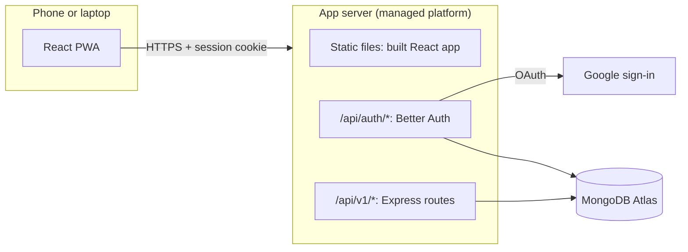
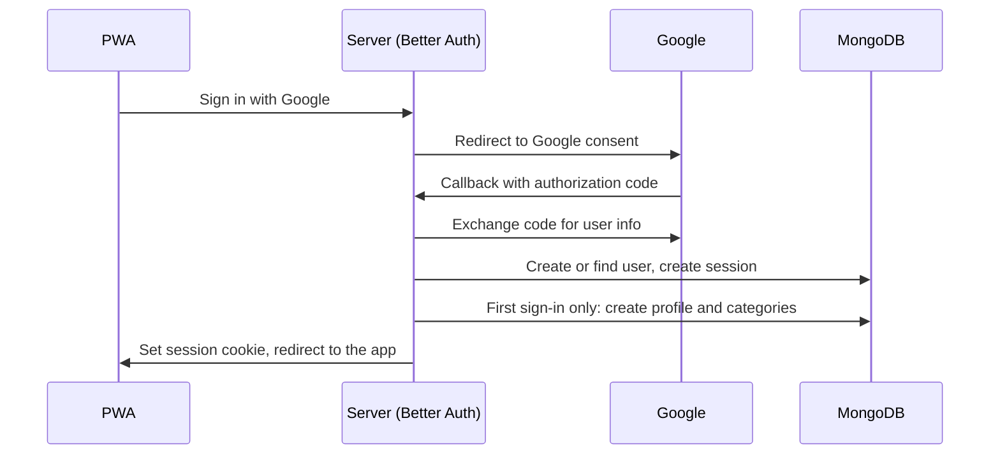
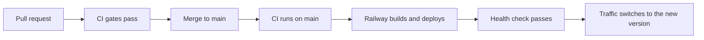
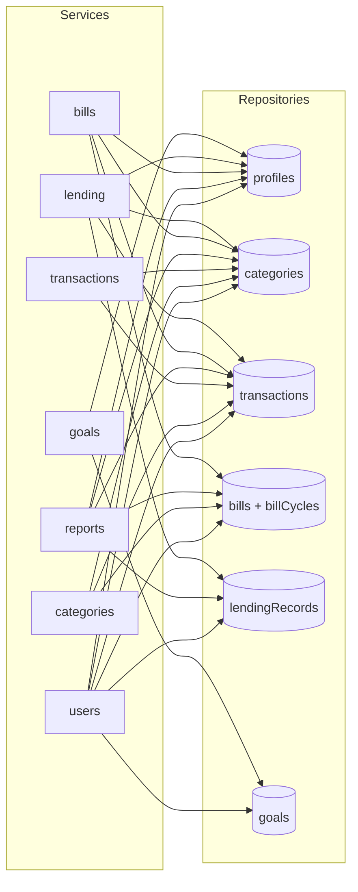

# Money Manager — Technical Design

This document describes **how** the app is built. `SPEC.md` describes **what** it does, and `UI.md` how it looks, feels and moves. When they disagree, the spec wins and the other documents are updated.

## 1. Key decisions

Technical decisions, `D-28` onward; product decisions `D-01`–`D-27` are in SPEC.md. Each records its date, what was chosen, why, what was rejected, and what it **binds** in the code. A decision binds implementers until the entry itself is changed here first, with a new date; a changed decision keeps its ID.

### 1.1 Hosting: one always-on server on a paid managed platform

- **ID:** D-28. **Decided:** 2026-11-10.
- **Chosen:** a single Node.js server on Railway's Hobby plan, within ₹500/month (details in Section 11).
- **Why:**
  - It stays always on, so there are no slow first loads (Spec Rule 4, the 5-second rule).
  - A normal long-running Express server is simpler than serverless: one database connection pool, no cold starts, no function size limits.
  - The platform provides HTTPS, a subdomain and deploys from git, so there is no server administration.
- **Rejected:**
  - *Serverless functions on a free tier:* free, but they need connection reuse tricks and behave differently from a normal server.
  - *A raw VPS:* cheaper, but adds Docker, a reverse proxy, TLS certificates and server maintenance.
  - *Free hosts that sleep when idle:* break the 5-second rule.
- **Region:** the server and the database run in the same region, as close to India as the platform allows.
- **Binds:** the server is a plain long-running Node process with no platform-specific code, so it can move hosts (SPEC Risks); `GET /api/health` exists for the platform (Section 11.2).

### 1.2 Frontend served by the same server

- **ID:** D-29. **Decided:** 2026-11-10.
- **Chosen:** the Express server serves the built React app as static files, and the API under `/api`.
- **Why:** one deploy, one domain. The session cookie is always first-party (Spec Rule 11), and no CORS setup is needed.
- **Rejected:** *a separate static host proxying `/api`:* two deploys to keep in sync, for no benefit at this size.
- **Binds:** every non-`/api` path serves `index.html`; no CORS middleware (Section 7.4).

### 1.3 Auth: Better Auth with Google sign-in

- **ID:** D-30. **Decided:** 2026-11-10.
- **Chosen:** Better Auth, using its MongoDB adapter and Google provider.
- **Why:**
  - TypeScript-first, and it runs inside the Express server.
  - Sessions are stored in the database, which makes "log out of all devices" (Spec Rule 10) a single delete.
  - It handles the OAuth flow, secure cookies and session expiry, which are easy to get wrong by hand.
- **Rejected:** *Passport.js + express-session:* more pieces to wire up manually, older and less type-safe. *Hosted auth (Clerk, Auth0):* least work, but a third party holds the user list.
- **Binds:** app code calls Better Auth only through the auth adapter in `auth/` (Section 9.6); app data never lives in Better Auth's collections (Section 5.2).

### 1.4 Database access: official MongoDB driver + Zod

- **ID:** D-31. **Decided:** 2026-11-10.
- **Chosen:** MongoDB Atlas (free tier), accessed with the official `mongodb` driver. Data shapes are defined once as Zod schemas.
- **Why:**
  - One Zod schema gives the TypeScript type, runtime validation of API input, and the same validation in the frontend form.
  - The driver is thin and close to how MongoDB actually works, which suits the learning goal.
  - Multi-document transactions (Spec Rule 11) work directly with the driver's sessions.
- **Rejected:** *Mongoose:* its schemas would duplicate the Zod schemas, and it hides some of what the database is doing. *A backend-as-a-service (Supabase, Firebase):* less code, but building the backend is part of the learning goal (Spec Rule 11).
- **Binds:** only repositories and `db/` import `mongodb` (Section 10.4); request and response shapes come from the shared Zod schemas.

### 1.5 Repo: pnpm workspaces monorepo

- **ID:** D-32. **Decided:** 2026-11-10.
- **Chosen:** one repository, managed with pnpm workspaces.
- **Why:** frontend and backend share types and validation through a shared package. One install, one CI pipeline, and a change across both sides lands in one commit.
- **Rejected:** *npm workspaces:* works, but pnpm is faster and stricter about undeclared dependencies. *Separate repositories:* every shared change would need coordinated releases.
- **Binds:** shared code lives only in `packages/shared` (Section 3); apps never import each other.

### 1.6 Versions and build

- **ID:** D-33. **Decided:** 2026-11-11.
- **Chosen:**
  - **Node.js 24 LTS** (pinned in `.nvmrc`, `engines.node` and CI) and **pnpm 10** (pinned with `packageManager`).
  - **The latest stable major version of every library** when issue #2 starts, including React 19, Tailwind CSS 4 (configured in CSS with `@theme`, as current shadcn/ui expects), Zod 4, React Router 7 in data mode (`createBrowserRouter`), Express 5 and Biome 2. Exact versions live in the lockfile; the README lists the majors.
  - **ES modules everywhere** (`"type": "module"`), TypeScript `strict`.
  - **TypeScript project references, built with `tsc -b`:** `packages/shared` and `apps/api` compile to their own `dist/` folders (JavaScript plus type declarations). The API uses `moduleResolution: "NodeNext"`; the web app uses `"Bundler"` and Vite builds it, reading `shared` through its package exports.
  - **Production start:** `node apps/api/dist/main.js`.
  - **Dates:** no date library. "Today in a timezone" uses the built-in `Intl.DateTimeFormat` with `timeZone`; calendar dates are `YYYY-MM-DD` strings with their arithmetic in `packages/shared/src/dates.ts` (Section 5.1).
- **Why:**
  - Node 24 is the active LTS line; Node 22 is in maintenance and reaches end of life in April 2027, during this project.
  - pnpm 10 blocks dependency install scripts unless allowed, which the dependency policy relies on (Section 10.10).
  - Tailwind 4 and Zod 4 change how tokens and validation messages are written (UI.md 4, Section 9.6), so the choice is made before code exists.
  - `tsc -b` needs no extra build tool, and the same compiled code runs in tests and production.
  - Dates here are plain calendar strings plus one "today" lookup, which `Intl` covers without adding a dependency.
- **Rejected:**
  - *Node 22 + pnpm 9:* would need a runtime upgrade within months.
  - *Bundling the API with tsup or esbuild:* one more tool for no benefit at this size.
  - *Running TypeScript directly in production:* production would run different code from what's type-checked.
  - *date-fns or Luxon:* adds weight to the web bundle for arithmetic a few small functions cover.
- **Binds:** `.nvmrc`, `engines` and CI all say Node 24; every date calculation goes through `packages/shared/src/dates.ts`.

### 1.7 Frontend: a React single-page app built with Vite

- **ID:** D-34. **Decided:** 2026-11-10.
- **Chosen:** React with Vite, as a single-page app (Section 8).
- **Why:** everything is behind sign-in, so server rendering adds nothing; Vite is fast and simple.
- **Rejected:** *Next.js:* server rendering and its own server model aren't needed, and they'd conflict with one Express server (D-29).
- **Binds:** no server rendering; the web app is static files plus `/api` calls.

### 1.8 Backend structure: feature modules, layers, plain functions

- **ID:** D-35. **Decided:** 2026-11-10.
- **Chosen:** one folder per feature, each with routes, service, repository and pure domain functions; plain factory functions wired by an awilix container (Sections 4.1–4.4).
- **Why:** a feature's code lives together; pure domain functions make the money rules easy to test.
- **Rejected:** *folders by layer* (all routes together); *classes*; *direct imports between services and repositories* (harder to swap fakes in tests).
- **Binds:** the layer rules in Section 4.2, enforced by dependency-cruiser (Section 10.4); the module map in Section 14.

### 1.9 Data modelling

- **ID:** D-36. **Decided:** 2026-11-10.
- **Chosen:** calendar dates as `YYYY-MM-DD` strings; MongoDB `ObjectId` ids; goal contributions and lending repayments embedded in their parent; bill cycles in their own collection; app settings in a `profiles` collection separate from Better Auth's users (Section 5).
- **Why:** strings never shift with timezones; small lists are simpler embedded; bill cycles grow forever; keeping auth data separate keeps the auth library replaceable.
- **Rejected:** *dates as midnight-UTC `Date` values; UUID ids; embedding everything; separate collections for everything; extending Better Auth's user with app fields.*
- **Binds:** the collection layouts in Section 5.3.

### 1.10 API style

- **ID:** D-37. **Decided:** 2026-11-10.
- **Chosen:** REST under `/api/v1`, a `{ success, data | error }` envelope, cursor pagination, amounts as integer paise (Section 6).
- **Why:** a version prefix leaves room for change; one envelope for every response; cursors don't skip or repeat items when new ones arrive.
- **Rejected:** *unwrapped responses; page-number pagination; amounts as rupee strings; no version prefix.*
- **Binds:** every endpoint follows Sections 6.1–6.3.

### 1.11 Duplicates and concurrent edits

- **ID:** D-38. **Decided:** 2026-11-11.
- **Chosen:** an idempotency key on every create, and a version number checked on every change (Sections 4.7, 6.4).
- **Why:** retrying a failed save must never duplicate money; an edit from another device must never be silently lost (D-17).
- **Rejected:** *last write wins; no duplicate protection; idempotency only for transactions.*
- **Binds:** every create accepts `idempotencyKey`; every change sends `version`; stale changes get `409 STALE_RECORD`.

### 1.12 Errors: thrown domain errors from one catalogue

- **ID:** D-39. **Decided:** 2026-11-11.
- **Chosen:** services throw typed domain errors; one shared catalogue of codes and messages; library errors translated at the boundary (Section 9).
- **Why:** one predictable error shape, and no library text ever reaches the user.
- **Rejected:** *Result types (neverthrow); each error writing its own message; Zod's default messages.*
- **Binds:** Section 9.6; error codes form a closed list in `packages/shared/src/errors.ts`.

### 1.13 Response shapes and API documentation

- **ID:** D-40. **Decided:** 2026-11-11.
- **Chosen:** every response passes through a response schema; the OpenAPI document is generated from the same schemas and checked in CI (Sections 6.6, 6.8).
- **Why:** internal fields can't leak, and the API description can't drift.
- **Rejected:** *returning database documents; a hand-written API document.*
- **Binds:** routes respond only through `respond(res, schema, data)`.

### 1.14 Sessions

- **ID:** D-41. **Decided:** 2026-11-10.
- **Chosen:** sessions stored in the database by Better Auth, in `httpOnly` cookies, expiring after 30 days without use; no list of devices, only "log out of all devices" (Section 7.3).
- **Why:** sliding expiry means daily use never signs me out; database sessions make logging out everywhere instant.
- **Rejected:** *fixed 30-day expiry; tokens in `localStorage`; a per-device session list.*
- **Binds:** no session cookie caching; every request checks the session (Section 7.3).

### 1.15 Frontend data and forms

- **ID:** D-42. **Decided:** 2026-11-10.
- **Chosen:** TanStack Query for server data, React Router, React Hook Form with the shared Zod schemas, no global store, no optimistic updates (Sections 8.4, 8.11).
- **Why:** caching, retries and loading states come built in; one schema validates both sides.
- **Rejected:** *`fetch` + `useEffect` by hand; TanStack Router; plain controlled inputs; a global state library; optimistic updates.*
- **Binds:** Section 8.11's state and refresh rules.

### 1.16 UI building blocks

- **ID:** D-43. **Decided:** 2026-11-10.
- **Chosen:** Tailwind CSS with shadcn/ui, Motion for animation, Recharts, Lucide icons, Inter self-hosted, a curated emoji list instead of a picker library (Section 8.1, UI.md).
- **Why:** accessible components that live in the repo; one animation library for gestures and layout; no third-party font requests.
- **Rejected:** *Material UI or Mantine; CSS-only animation; Chart.js; Phosphor icons; Google Fonts; an emoji picker library.*
- **Binds:** design tokens only (UI.md 4), checked in CI (Section 10.2).

### 1.17 Quality tooling and testing

- **ID:** D-44. **Decided:** 2026-11-10; additions 2026-11-11.
- **Chosen:** Biome; husky and lint-staged; gitleaks; dependency-cruiser; Vitest with fast-check property tests; Supertest against an in-memory MongoDB; Playwright for the critical flows only (Section 10).
- **Why:** one fast linter and formatter; boundaries and secrets checked by machines; real database behaviour in API tests.
- **Rejected:** *ESLint + Prettier; no pre-commit hook; Biome's restricted-imports rule for boundaries; mocking the database; end-to-end tests for every screen.*
- **Binds:** Sections 10.1–10.4 and 10.8.

### 1.18 Workflow and releases

- **ID:** D-45. **Decided:** 2026-11-10.
- **Chosen:** GitHub with Actions; a branch and pull request per issue; squash merge; Conventional Commits; release notes generated from labels (Section 10.7).
- **Why:** the same flow a team would use, enforced by CI rather than memory.
- **Rejected:** *committing straight to `main`; merge commits or rebase merges; release-please.*
- **Binds:** Section 10.7; every pull request closes an issue (the planning pull request #61 is the one recorded exception).

### 1.19 Environments and monitoring

- **ID:** D-46. **Decided:** 2026-11-10.
- **Chosen:** local and production only, two Atlas projects, Railway's subdomain, Railway's email alerts (Section 11).
- **Why:** a staging copy, a custom domain and a monitoring service each cost money or upkeep a personal app doesn't need yet.
- **Rejected:** *a staging environment; a custom domain; third-party error tracking or uptime monitoring.*
- **Binds:** Sections 11.1 and 11.7.

### 1.20 Security posture

- **ID:** D-47. **Decided:** 2026-11-10; additions 2026-11-11.
- **Chosen:** strict security headers and a Content Security Policy with no inline scripts; `SameSite=Lax` cookies plus an Origin check; `trust proxy` of 1; rate limits; `pnpm audit` in CI (Sections 7.4, 7.6).
- **Why:** a money app's main risks are injected scripts, cross-site requests and leaked data.
- **Rejected:** *CORS middleware; session cookie caching; trusting any number of proxies.*
- **Binds:** Section 7.6; the built `index.html` contains no inline script.

### 1.21 Google sign-in publishing

- **ID:** D-48. **Decided:** 2026-11-10; logo 2026-11-11.
- **Chosen:** the Google app stays in Testing mode, with the app name, my email and the app icon on the consent screen (Section 7.5).
- **Why:** Testing mode keeps strangers out and needs no Google review.
- **Rejected:** *publishing to Production* (needs a privacy policy and, with a logo, brand verification).
- **Binds:** new users are added as Google test users.

### 1.22 Traceability and drift checks

- **ID:** D-49. **Decided:** 2026-11-11.
- **Chosen:** requirement IDs in SPEC.md; issues declare the requirements and decisions they implement; `TRACEABILITY.md` is generated from the spec, the backlog source and the tests; CI fails when they drift (Section 10.2).
- **Why:** "done" must be checkable, and docs, issues and code must not silently disagree.
- **Rejected:** *a hand-written traceability table; keeping the checks on one machine; a separate spec repository with a pinned version* (the spec and code share one repository, so they're versioned together).
- **Binds:** `tools/backlog/` and `tools/docs/` live in the repository; test names carry requirement IDs (Section 10.8).

### 1.23 Engineering principles as checkable rules

- **ID:** D-50. **Decided:** 2026-11-11.
- **Chosen:** single responsibility, no duplication, YAGNI, composition, strong types and defensive engineering written as checkable rules (Section 15): cognitive complexity at most 15; copy-paste detection with jscpd; size limits checked in review; branded types for money, dates and ids; timeouts; tighter limits on expensive endpoints.
- **Why:** principles only hold when something checks them; slogans like "production grade" don't.
- **Rejected:** *a stricter complexity limit of 10; review-only duplication checks; no numeric size guidance; plain `number` and `string` for money and ids; one rate limit for everything.*
- **Binds:** Section 15; the tools in Section 10.4; the definition of done (Section 10.5).

## 2. Architecture overview



**Components:**

- **React PWA:** the whole user interface. Installable on phones. It has no offline data (Spec Rule 3); its service worker only caches the app's own files so it loads fast.
- **App server:** one Express process that serves three things:
  - the built React app as static files, for any path not under `/api`
  - Better Auth under `/api/auth/*`, for Google sign-in, sessions and logout
  - the app's REST API under `/api/v1/*`, and the health check at `/api/health`
- **MongoDB Atlas:** stores all app data and the auth sessions.
- **Google:** only involved during sign-in.

**A typical request** (adding an expense):

1. The PWA sends `POST /api/v1/transactions` with the session cookie.
2. The server checks the session and finds the user.
3. The input is validated against the shared Zod schema.
4. The business rules run, and the transaction is written to MongoDB, owned by that user.
5. The server returns the saved transaction; the PWA updates the screen.

**No background jobs.** Everything time-based is either calculated when data is read, or handled by the database:

| Behaviour                                   | How                                                    |
| ------------------------------------------- | ------------------------------------------------------ |
| Upcoming and overdue bills, goals, lending  | Calculated on read, using "today" in the user's timezone |
| Backup reminder                             | Calculated on read from the user's last backup date    |
| Emptying the Trash after 30 days            | A MongoDB TTL index on `deletedAt`                     |

This means there is no scheduler to run, monitor or pay for.

**Time:** the server always calculates "today" from the user's stored timezone (Spec Rule 9), never from the server's clock or the device's clock alone.

## 3. Repo structure

```text
money-manager/
├── apps/
│   ├── api/                      Express server
│   │   ├── scripts/              seed-dev.ts, migrations/ (Sections 11.5, 11.8)
│   │   └── src/
│   │       ├── main.ts           starts the server
│   │       ├── app.ts            builds the Express app (used by main.ts and API tests)
│   │       ├── container.ts      awilix container: registers everything
│   │       ├── config.ts         reads and validates environment variables (the only file that reads process.env)
│   │       ├── errors.ts         AppError and its subclasses (Section 9.2)
│   │       ├── db/               MongoDB client, indexes, transaction helper, driver-error translation
│   │       ├── auth/             Better Auth setup and the auth adapter (Section 9.6)
│   │       ├── middleware/       requireAuth, origin check, validate, rate limit, error handler
│   │       └── modules/          one folder per feature (see section 4)
│   │           ├── users/        signup setup, settings, backup, account deletion
│   │           ├── categories/
│   │           ├── transactions/
│   │           ├── reports/
│   │           ├── bills/
│   │           ├── lending/
│   │           └── goals/
│   └── web/                      React + Vite PWA (see section 8)
├── packages/
│   └── shared/                   used by both api and web
│       └── src/
│           ├── schemas/          Zod schemas and their TypeScript types
│           ├── errors.ts         error codes and the message catalogue (Section 9.6)
│           ├── money.ts          paise conversion and ₹ formatting
│           └── dates.ts          calendar dates and timezone helpers
├── e2e/                          Playwright end-to-end tests (Section 10.2)
├── docs/openapi.json             generated API description (Section 6.8)
├── tools/
│   ├── backlog/                  issue source (issues.md) and the script that creates and verifies GitHub issues
│   └── docs/                     check.mjs: references, IDs and traceability (Section 10.2)
├── TRACEABILITY.md               generated: requirement → issues → module → tests
├── .github/                      CI workflow, issue and PR templates, Dependabot, release notes config
├── AGENTS.md                     conventions for AI agents and humans
├── SPEC.md
├── DESIGN.md
├── UI.md
├── biome.json
├── .dependency-cruiser.cjs       import boundary rules (Section 10.4)
└── pnpm-workspace.yaml
```

**What goes in `packages/shared`:** only code that both the frontend and backend need: Zod schemas, the error catalogue, money and date helpers. Business rules that only the server runs stay in `apps/api`.

## 4. Backend layers and patterns

### 4.1 Feature modules

Each feature in `apps/api/src/modules/` has the same files:

```text
modules/bills/
├── bills.routes.ts        HTTP: paths, validation, status codes
├── bills.service.ts       use cases: "pay a bill", "skip a cycle"
├── bills.repository.ts    MongoDB reads and writes
├── bills.domain.ts        pure business rules
└── bills.domain.test.ts   unit tests for the domain functions
```

A feature with no complex rules (e.g. categories) may have no `domain.ts`.

### 4.2 Layers

| Layer          | Does                                                         | Never                                    |
| -------------- | ------------------------------------------------------------ | ---------------------------------------- |
| **Routes**     | Parse the request, validate input with Zod, call one service function, send the response through `respond` (Section 6.6) | Touch the database or contain business rules |
| **Service**    | Run a use case: load data, apply domain rules, save, wrap multi-record writes in a DB transaction | Use `req` / `res`                       |
| **Repository** | Read and write one collection, always filtered by user; translate driver errors into domain errors (Section 9.6) | Contain business rules, or let a MongoDB error escape |
| **Domain**     | Pure functions: same input, same output, no database, no clock | Import anything except `packages/shared`, `errors.ts` and its own module's types |

Allowed calls go one way: routes → service → repository and domain. These boundaries are enforced by dependency-cruiser in CI (Section 10.4).

**Domain examples** (Spec Rule 16 tests live here):

- `nextDueDate(dueDate, dueDay, frequency)` — bill date rolling, including the 29th–31st
- `remainingAmount(record, repayments)` and `isSettled(...)` — lending
- `goalStatus(goal, contributions, today)` — savings goals
- `calculateBalance(openingBalance, openingDate, transactions)`
- `comparisonRange(month, today)` — month comparison date ranges

Domain functions receive "today" as a parameter instead of reading the clock, so tests can pass any date.

### 4.3 Code style

- Plain functions and modules; no classes.
- Each service and repository is a factory function that receives its dependencies and returns an object of functions:

```ts
export function createBillsService({ billsRepository, transactionsRepository, db }: Deps) {
  return {
    async payBill(userId: string, billId: string, input: PayBillInput) { /* ... */ },
    async skipCycle(userId: string, billId: string, input: SkipCycleInput) { /* ... */ },
  };
}
```

### 4.4 Dependency injection: awilix

- `container.ts` registers the database, config, every repository and every service with awilix, as singletons.
- Factory functions receive their dependencies by name from the container (e.g. `{ billsRepository }`).
- Routes resolve the service they need from the container.
- API tests build a container with fake or test-database dependencies.

### 4.5 Ownership rule

Ownership is enforced in the repository layer, so it can't be forgotten (Spec Rule 10):

- Every service function takes the logged-in `userId` as its first argument. It comes from the session, never from the request body.
- Every repository query includes `userId` in its filter, including updates and deletes.
- A record that exists but belongs to someone else is treated exactly like a record that doesn't exist (404), so other users' ids can't be probed.

### 4.6 Cross-feature writes and DB transactions

Some actions write to more than one feature (e.g. paying a bill creates a transaction).

- A service may call **another feature's repository** for this, never another feature's routes.
- Multi-record writes run inside `withTransaction(async (session) => { ... })` from `db/`. Every repository function accepts an optional `session`, so all writes in the block commit or roll back together (Spec Rule 11).

### 4.7 Stale edits: record versions

Spec Rule 9 says an edit made on one device must never silently overwrite a newer change from another device. This uses **optimistic concurrency**:

- Every document has an integer `version`, starting at 1.
- Every response that returns a record includes its `version`.
- **Every request that changes an existing document** must send the `version` it last saw: every `PATCH` and `DELETE`, and every `POST` action on an existing record (paying, skipping, undoing, pausing or resuming a bill; restoring from the Trash; adding a repayment or contribution, which changes the parent document).
- The repository updates with a filter on `{ _id, userId, version }` and increments `version` in the same write. If nothing matched but the record exists, someone else changed it first: the API returns `409 STALE_RECORD`.
- Changes to embedded items (goal contributions, lending repayments) use the parent document's `version`.
- The frontend shows "This was changed on another device" with **Reload**, which refetches the record (UI.md 7.1).
- Creating records needs no version. Bill payments are protected by the unique `billCycles` index instead (Section 5.4).

## 5. Database collections and indexes

### 5.1 Conventions

- **Ids:** MongoDB `ObjectId` for every document and every embedded item. Sent to the frontend as strings.
- **Owner:** every app collection has a `userId` field (Section 4.5).
- **Money:** whole numbers of paise, always positive. Whether money comes in or goes out is decided by `type` or `direction`, never by a minus sign. Zod checks every amount is an integer. The one exception is `openingBalance`, which is signed (Spec Rule 9).
- **Calendar dates** (transaction date, due dates, deadlines): `"YYYY-MM-DD"` strings. They never shift with timezones, and they sort and compare correctly as plain strings. All date arithmetic lives in `packages/shared/src/dates.ts`, with no date library (Section 1.6).
- **Timestamps** (`createdAt`, `updatedAt`, `deletedAt`, `completedAt`, `settledAt`, `lastBackupAt`): MongoDB `Date` values, in UTC.
- **Indexes and validators** are created by `db/indexes.ts` when the server starts (Sections 5.4, 5.6).
- **Text** is stored trimmed and Unicode-normalized (NFC) (Spec Rule 9); empty optional text is stored as `null`, never `""`. Uniqueness checks (`nameLower`) compare the normalized, lowercased form.
- **Types:** money, dates and ids have branded TypeScript types (Section 15.5), so repositories can't mix up an amount, a date and an id.

### 5.2 Auth collections

Better Auth creates and manages its own collections for users, sessions and linked Google accounts. App code never writes to them directly; it only reads the user's id from the session. The Better Auth user id is the `userId` used everywhere else.

### 5.3 App collections

**`profiles`** — app settings for a user, one per user.

| Field                | Type          | Notes                     |
| -------------------- | ------------- | ------------------------- |
| `userId`             | string        | Better Auth user id       |
| `timezone`           | string        | e.g. `"Asia/Kolkata"`     |
| `openingBalance`     | integer paise | signed: may be zero or negative |
| `openingBalanceDate` | date string   |                           |
| `currency`           | string        | `"INR"`                   |
| `lastBackupAt`       | Date or null  |                           |
| `onboardedAt`        | Date or null  | null until the signup flow is finished or skipped (Section 7.2) |

**`categories`**

| Field       | Type    | Notes                                   |
| ----------- | ------- | --------------------------------------- |
| `userId`    | string  |                                         |
| `name`      | string  | trimmed, original letter case kept      |
| `nameLower` | string  | lowercase copy, for the uniqueness rule |
| `emoji`     | string  | a single emoji, e.g. `"🍔"`             |
| `type`      | string  | `"expense"`, `"income"` or `"both"`     |
| `builtIn`   | boolean | true only for Lending                   |

**`transactions`**

| Field        | Type            | Notes                                                  |
| ------------ | --------------- | ------------------------------------------------------ |
| `userId`     | string          |                                                        |
| `type`       | string          | `"expense"` or `"income"`                              |
| `amount`     | integer paise   |                                                        |
| `currency`   | string          | `"INR"`                                                |
| `categoryId` | ObjectId        |                                                        |
| `date`       | date string     |                                                        |
| `payee`      | string or null  |                                                        |
| `note`       | string or null  |                                                        |
| `source`     | object          | `{ kind: "manual" }`, `{ kind: "bill", billCycleId }`, `{ kind: "lending", recordId, repaymentId? }` |
| `deletedAt`  | Date or null    | set when moved to the Trash                            |
| `idempotencyKey` | string or null | client-generated UUID, prevents duplicate saves on retry (Section 6.4) |

**`goals`** — contributions are embedded.

| Field           | Type               | Notes                                  |
| --------------- | ------------------ | -------------------------------------- |
| `userId`        | string             |                                        |
| `name`          | string             |                                        |
| `targetAmount`  | integer paise      |                                        |
| `currency`      | string             |                                        |
| `deadline`      | date string or null|                                        |
| `icon`          | string             | a single emoji, default `"🎯"`         |
| `contributions` | array              | `{ _id, amount, date, idempotencyKey }`     |
| `completedAt`   | Date or null       |                                        |

**`bills`**

| Field         | Type          | Notes                                     |
| ------------- | ------------- | ----------------------------------------- |
| `userId`      | string        |                                           |
| `name`        | string        |                                           |
| `amount`      | integer paise | the usual amount                          |
| `currency`    | string        |                                           |
| `categoryId`  | ObjectId      |                                           |
| `frequency`   | string        | `"monthly"` or `"quarterly"`              |
| `dueDay`      | integer 1–31  | day of month from the first due date      |
| `nextDueDate` | date string   |                                           |
| `paused`      | boolean       |                                           |
| `note`        | string or null|                                           |

**`billCycles`** — a separate collection, because it grows every month for as long as a bill exists.

| Field           | Type             | Notes                    |
| --------------- | ---------------- | ------------------------ |
| `userId`        | string           |                          |
| `billId`        | ObjectId         |                          |
| `dueDate`       | date string      | the cycle this closes    |
| `status`        | string           | `"paid"` or `"skipped"`  |
| `amount`        | integer paise or null | amount paid         |
| `transactionId` | ObjectId or null | set when paid            |

**`lendingRecords`** — repayments are embedded.

| Field           | Type               | Notes                                          |
| --------------- | ------------------ | ---------------------------------------------- |
| `userId`        | string             |                                                |
| `person`        | string             |                                                |
| `direction`     | string             | `"lent"` or `"borrowed"`                       |
| `amount`        | integer paise      | original amount                                |
| `currency`      | string             |                                                |
| `date`          | date string        |                                                |
| `dueDate`       | date string or null|                                                |
| `note`          | string or null     |                                                |
| `transactionId` | ObjectId           | the transaction for the original lend/borrow   |
| `repayments`    | array              | `{ _id, amount, date, transactionId, idempotencyKey }` |
| `settledAt`     | Date or null       |                                                |

Every collection also has `_id`, `createdAt`, `updatedAt` and `version` (Section 4.7). `categories`, `bills`, `goals` and `lendingRecords` also have an `idempotencyKey`, like `transactions` (Section 6.4).

### 5.4 Indexes

| Collection       | Index                                    | Purpose                                                    |
| ---------------- | ---------------------------------------- | ---------------------------------------------------------- |
| `profiles`       | `{ userId: 1 }` unique                   | one profile per user                                       |
| `categories`     | `{ userId: 1, nameLower: 1 }` unique     | category names unique per user (Spec Rule 5)               |
| `transactions`   | `{ userId: 1, date: -1 }`                | transaction list, monthly totals, balance                  |
| `transactions`   | `{ userId: 1, categoryId: 1, date: -1 }` | category filters and reports                               |
| `transactions`   | `{ userId: 1, payee: 1 }`                | payee autocomplete                                         |
| `transactions`   | `{ deletedAt: 1 }` TTL, 30 days          | empties the Trash automatically (Spec Rule 9)              |
| `transactions`   | `{ userId: 1, deletedAt: -1 }`           | the Trash list, newest deletion first                      |
| `transactions`, `categories`, `bills`, `goals`, `lendingRecords` | `{ userId: 1, idempotencyKey: 1 }` unique, only where `idempotencyKey` is set | a retried create can't make a duplicate (Section 6.4) |
| `goals`          | `{ userId: 1, completedAt: 1 }`          | active and completed lists                                 |
| `bills`          | `{ userId: 1, nextDueDate: 1 }`          | upcoming and overdue bills                                 |
| `billCycles`     | `{ billId: 1, dueDate: 1 }` unique       | history; **makes paying the same cycle twice impossible**  |
| `lendingRecords` | `{ userId: 1, settledAt: 1 }`            | open and settled lists                                     |
| `lendingRecords` | `{ userId: 1, person: 1 }`               | person autocomplete                                        |

Search by note or payee scans the user's transactions with the `userId` index. At one person's data volume this is fast enough; a text index can be added later if needed.

### 5.5 Deleting an account

Deleting an account (Spec Rule 10) runs in one DB transaction: delete every document with that `userId` from every app collection. Then the user's Better Auth data (user, sessions, linked accounts) is deleted through Better Auth. Both steps are safe to repeat, so if the second one fails the request returns an error and can simply be retried.

### 5.6 Database validators (second safety net)

Zod in the API is the main validation (Section 9.1). As a second line of defence, every app collection also has a **MongoDB `$jsonSchema` validator**, so even a buggy code path can't store bad money data:

- Required fields and their BSON types (e.g. `amount` is an integer, `date` is a `YYYY-MM-DD` string, `userId` is present).
- Money fields are integers greater than 0 (`openingBalance` excepted: signed).
- Enum fields only accept their values (`type`, `direction`, `frequency`, `status`).
- `version` is an integer of at least 1.
- `validationLevel: "strict"`, `validationAction: "error"`.

Validators are created and updated with each collection in `db/indexes.ts` at startup. A validator rejection is a bug: the repository lets it surface as a logged `500` (Section 9.6), never as a message to the user.

## 6. API contract

### 6.1 Conventions

- **Base path:** `/api/v1`. Better Auth's own endpoints live at `/api/auth/*` and are not versioned.
- **Format:** JSON in and out. Field names in `camelCase`.
- **Amounts:** integers in paise, in both directions. The frontend converts to and from ₹ for display (`packages/shared/money.ts`).
- **Dates:** calendar dates as `"YYYY-MM-DD"`, months as `"YYYY-MM"`, timestamps as ISO 8601 strings in UTC.
- **Auth:** every `/api/v1` endpoint requires a valid session cookie, or returns `401`.
- **Validation:** every request body and query is validated with the shared Zod schema before reaching the service.
- **Versions:** every request that changes an existing document includes its `version` in the body (Section 4.7). The exceptions are account deletion (`DELETE /me`) and `GET /me/backup`'s update of `lastBackupAt`, which can't conflict with an edit.
- **Body size:** JSON bodies are limited to 100 KB; larger ones get `413 PAYLOAD_TOO_LARGE`.

### 6.2 Response envelope

Success:

```json
{ "success": true, "data": { "id": "6730f1...", "amount": 12550, "type": "expense" } }
```

Failure:

```json
{
  "success": false,
  "error": {
    "code": "VALIDATION_ERROR",
    "message": "Check the highlighted fields.",
    "details": [{ "field": "amount", "message": "Amount must be more than ₹0" }],
    "requestId": "b7e3c1f0-2a4d-4c55-9a1e-6f2d8c0e9a31"
  }
}
```

| HTTP status | `error.code`        | When                                                             |
| ----------- | ------------------- | ---------------------------------------------------------------- |
| 400         | `VALIDATION_ERROR`  | input fails the Zod schema, or the body isn't valid JSON         |
| 401         | `UNAUTHENTICATED`   | no valid session                                                 |
| 403         | `FORBIDDEN`         | a changing request without the app's own `Origin` (Section 7.4)  |
| 404         | `NOT_FOUND`         | record doesn't exist **or belongs to another user** (Section 4.5) |
| 409         | `CONFLICT`          | duplicate category name, bill cycle already paid                 |
| 409         | `STALE_RECORD`      | the record was changed since the client loaded it (Section 4.7)  |
| 413         | `PAYLOAD_TOO_LARGE` | body larger than 100 KB                                          |
| 422         | `RULE_VIOLATION`    | valid input that breaks a spec rule, e.g. repayment larger than the remaining amount |
| 429         | `RATE_LIMITED`      | too many requests                                                |
| 500         | `INTERNAL_ERROR`    | anything unexpected; details are logged, never sent to the client |
| —           | `NETWORK_ERROR`     | frontend only: the request never got a response (offline, timeout) |

This list is **closed**: these are the only codes, defined once in `packages/shared/src/errors.ts` (Section 9.6). Every failure response also includes the request id from the `X-Request-Id` header, as `error.requestId`, so a bug report can be matched to the logs. Section 9 covers how errors are raised and handled in code.

### 6.3 Pagination

Lists that can grow large (transactions, Trash) use cursor pagination:

- Request: `?limit=50&cursor=<opaque string>`. Default limit 50, maximum 100.
- Response: `{ "items": [...], "nextCursor": "..." }`. `nextCursor` is `null` on the last page.
- Transactions are sorted by `date` descending, then `_id` descending; the Trash by `deletedAt` descending, then `_id`. The cursor encodes the sort values, so adding new items never shifts or repeats them.

Small lists (categories, bills, goals, lending records) are returned whole, without pagination.

### 6.4 Duplicate protection

**Every create request** accepts an optional `idempotencyKey`, a UUID the form generates once when it opens: transactions, categories, bills, goals, lending records, and the embedded repayments and contributions. If a request with the same `idempotencyKey` was already saved, the server returns the existing item (with `200` instead of `201`) instead of creating another; the second request's body isn't compared, because a retry always resends the same form. This makes **Retry** after a failed save safe (Spec Rule 4).

- Top-level documents are protected by the unique `{ userId, idempotencyKey }` indexes (Section 5.4).
- Embedded items (repayments, contributions) are checked by the service: if the parent already has an item with that `idempotencyKey`, it's returned before the version check, so a retry never shows a false "changed on another device".
- Bill payments are also protected by the unique `billCycles` index (Section 5.4).

### 6.5 Endpoints

All paths below are under `/api/v1`. Fixed sub-paths (`/transactions/trash`, `/transactions/payees`, `/lending/people`) are registered **before** the `/:id` routes, so they're never mistaken for an id.

**Profile and account**

| Method | Path                | Does                                                         |
| ------ | ------------------- | ------------------------------------------------------------ |
| GET    | `/me`               | name, email and profile settings                             |
| PATCH  | `/me`               | update timezone, opening balance, opening balance date       |
| GET    | `/me/backup`        | download all data as a JSON file; updates `lastBackupAt`     |
| DELETE | `/me`               | delete account; body `{ confirmation }` must match the phrase |

Log out and log out of all devices use Better Auth's endpoints under `/api/auth/*`.

**Health** (no auth, outside `/api/v1`)

| Method | Path          | Does                                                    |
| ------ | ------------- | ------------------------------------------------------- |
| GET    | `/api/health` | `200` if the server can reach the database (Section 11.2) |

**Home**

| Method | Path    | Does                                                                                   |
| ------ | ------- | -------------------------------------------------------------------------------------- |
| GET    | `/home` | balance, this month's totals, top 3 categories, 5 most recent transactions, upcoming and overdue bills, overdue lending, backup reminder flag |

**Categories**

| Method | Path              | Does                                                                  |
| ------ | ----------------- | --------------------------------------------------------------------- |
| GET    | `/categories`     | all categories                                                        |
| POST   | `/categories`     | create                                                                |
| PATCH  | `/categories/:id` | change name, emoji, or type (type only while unused)                  |
| DELETE | `/categories/:id` | delete; body `{ moveToCategoryId }` required if it has transactions or bills |

**Transactions**

| Method | Path                              | Does                                                     |
| ------ | --------------------------------- | -------------------------------------------------------- |
| GET    | `/transactions`                   | list; filters `from`, `to`, `categoryId`, `q`; paginated |
| POST   | `/transactions`                   | create a manual transaction                              |
| GET    | `/transactions/:id`               | one transaction                                          |
| PATCH  | `/transactions/:id`               | edit (manual transactions only)                          |
| DELETE | `/transactions/:id`               | move to Trash (manual transactions only)                 |
| GET    | `/transactions/trash`             | Trash list; paginated                                    |
| POST   | `/transactions/:id/restore`       | restore from Trash                                       |
| DELETE | `/transactions/:id/permanent`     | delete permanently from Trash                            |
| GET    | `/transactions/payees?q=`         | payee autocomplete                                       |

Editing or deleting a bill or lending transaction directly returns `422 RULE_VIOLATION` (Spec Rule 9).

**Reports** — all accept `includeLending=true|false` (default `true`, Spec Rule 8).

| Method | Path                               | Does                                                     |
| ------ | ---------------------------------- | -------------------------------------------------------- |
| GET    | `/reports/summary?month=`          | spent per category with shares, plus spent, income and left over, for the month (Spec Rule 9, Counting money); also `firstMonth` and `lastMonth`, the range the month picker may show (Spec Rule 5). A month outside that range returns `400` |
| GET    | `/reports/trend?months=6`          | spent per month, for the bar chart (maximum 12 months)   |
| GET    | `/reports/comparison?month=`       | per-category comparison with the previous month, same date range |

**Bills**

| Method | Path                  | Does                                               |
| ------ | --------------------- | -------------------------------------------------- |
| GET    | `/bills`              | all bills, with upcoming/overdue status            |
| POST   | `/bills`              | create                                             |
| GET    | `/bills/:id`          | one bill with its cycle history                    |
| PATCH  | `/bills/:id`          | edit                                               |
| DELETE | `/bills/:id`          | delete; past transactions become manual            |
| POST   | `/bills/:id/pay`      | pay the current cycle; body `{ amount }`           |
| POST   | `/bills/:id/skip`     | skip the current cycle                             |
| POST   | `/bills/:id/undo`     | undo the most recent cycle                         |
| POST   | `/bills/:id/pause`    | pause                                              |
| POST   | `/bills/:id/resume`   | resume; body `{ nextDueDate }`                     |

**Lending**

| Method | Path                                   | Does                                         |
| ------ | -------------------------------------- | -------------------------------------------- |
| GET    | `/lending`                             | records; filters `direction`, `status`       |
| POST   | `/lending`                             | create a record and its transaction          |
| GET    | `/lending/:id`                         | one record with repayments                   |
| PATCH  | `/lending/:id`                         | edit; updates its transaction                |
| DELETE | `/lending/:id`                         | delete record, repayments and transactions   |
| POST   | `/lending/:id/repayments`              | add a repayment and its transaction          |
| PATCH  | `/lending/:id/repayments/:repaymentId` | edit a repayment                             |
| DELETE | `/lending/:id/repayments/:repaymentId` | delete a repayment and its transaction       |
| GET    | `/lending/people?q=`                   | person autocomplete                          |

**Goals**

| Method | Path                                        | Does                          |
| ------ | ------------------------------------------- | ----------------------------- |
| GET    | `/goals`                                    | goals; filter `status`        |
| POST   | `/goals`                                    | create                        |
| GET    | `/goals/:id`                                | one goal with contributions   |
| PATCH  | `/goals/:id`                                | edit                          |
| DELETE | `/goals/:id`                                | delete                        |
| POST   | `/goals/:id/contributions`                  | add a contribution            |
| PATCH  | `/goals/:id/contributions/:contributionId`  | edit a contribution           |
| DELETE | `/goals/:id/contributions/:contributionId`  | delete a contribution         |

### 6.6 Response shapes: no data leakage

The mirror of the error discipline (Section 9.6): **only fields the client needs leave the server.**

- Every endpoint has a **response schema** in `packages/shared/src/schemas/`, next to its request schema. The web app uses the same schemas as its types.
- Repositories map database documents to plain domain objects; routes send them through the endpoint's response schema with a single `respond(res, schema, data)` helper. Raw MongoDB documents are never sent.
- **Never in a response:** `userId`, `nameLower`, `idempotencyKey`, `_id` (sent as `id`, a string), BSON types, or any Better Auth data beyond the user's name and email on `GET /me`.
- Ids are strings, money is integer paise, calendar dates are `YYYY-MM-DD`, timestamps are ISO 8601 strings (Section 6.1).
- In development and tests, `respond` **fails** if the data has a field the schema doesn't list, so a leak is caught immediately. In production it strips unknown fields and logs a warning.
- The backup download (`GET /me/backup`) has its own export schema; it includes ids, so a future restore can rebuild links, but still no `userId` or auth data.

### 6.7 HTTP caching

| Response                                  | `Cache-Control`                                   |
| ----------------------------------------- | ------------------------------------------------- |
| Every `/api/*` response                   | `no-store`: financial data is never cached by the browser or a proxy |
| `index.html` and the service worker file  | `no-cache`: always checked, so new deploys are picked up |
| Hashed build assets (`/assets/*`)         | `public, max-age=31536000, immutable`            |
| Icons, manifest                           | `public, max-age=86400`                           |

### 6.8 OpenAPI document

- `docs/openapi.json` is **generated** from the shared Zod request and response schemas and the route list, never written by hand.
- `pnpm gen:openapi` regenerates it. CI regenerates it and fails if the committed file differs, so the document can't drift from the code (Section 10.2).
- It can be opened in any OpenAPI viewer or imported into Postman for manual testing.

## 7. Auth and sessions

### 7.1 Sign-in flow



Better Auth handles every step of the OAuth exchange. The app only adds the first-sign-in setup.

### 7.2 First sign-in setup (Spec Rule 13)

- A Better Auth hook runs after a user is created and calls `ensureProfile(userId)`, which creates:
  - the profile, with timezone `Asia/Kolkata`, opening balance 0 and `onboardedAt` null
  - the default categories and the built-in Lending category
- `ensureProfile` does nothing if the profile already exists. The auth middleware also calls it when a signed-in user has no profile, so a failed hook can never leave a user without one.
- While `onboardedAt` is null, the PWA shows the welcome screen (UI.md 3.9). **Continue** sends the timezone (detected from the device, changeable) and the opening balance and its date with `PATCH /me`; **Skip** sends only the timezone. Either way `PATCH /me` sets `onboardedAt`, so the welcome screen never appears again.

### 7.3 Sessions

- Stored in MongoDB by Better Auth; the cookie holds only the session token.
- Cookie: `httpOnly`, `Secure` in production, `SameSite=Lax`.
- **Sliding expiry:** a session expires after 30 days without use. Better Auth extends it at most once a day when it's used, so it isn't rewritten on every request.
- Every request checks the session against the database (no cookie caching), so logging out of all devices takes effect immediately.
- **Log out:** deletes the current session. **Log out of all devices:** deletes every session of the user. Both use Better Auth's built-in endpoints.

### 7.4 Protecting the API

- **`requireAuth` middleware** on every `/api/v1` route: reads the session through Better Auth, puts the user id on the request, and returns `401 UNAUTHENTICATED` if there is none. Services receive this id as `userId` (Section 4.5).
- **Cross-site request protection:** `SameSite=Lax` stops the browser sending the cookie with requests from other sites. In addition, every `POST`, `PATCH` and `DELETE` must have an `Origin` header matching the app's own origin, or it gets `403 FORBIDDEN`.
- **Behind Railway's proxy:** Express runs with `trust proxy` set to `1`, so it sees the real client IP (for rate limits and logs) and knows the original request was HTTPS (for `Secure` cookies). It trusts exactly one proxy hop, so a client can't fake its IP with its own `X-Forwarded-For` header.
- **No CORS:** the app and the API share one origin (Section 1.2), so no CORS middleware is installed; cross-origin requests get no permissive headers.
- **Rate limits:** Better Auth's built-in limiter on `/api/auth/*`; `express-rate-limit` on `/api/v1`, keyed by user id when signed in and by IP address otherwise. Defaults, adjustable in config: **300 requests per 5 minutes per user** on `/api/v1`, and **30 per 5 minutes per IP** on `/api/auth/*`. Expensive or dangerous endpoints have tighter limits on top, per user: **`GET /me/backup` 10 per hour** and **`DELETE /me` 3 per hour** (FR-10.10, Section 15.6).

### 7.5 Google setup

- One Google Cloud OAuth client, with the production and local callback URLs registered.
- Only the basic `email` and `profile` scopes are requested.
- The client id, client secret and Better Auth's signing secret are environment variables (Section 11), never committed.
- **Publishing status: Testing.** Only Google accounts listed as test users can sign in (me, and family later). This needs no privacy policy or Google verification, and keeps strangers out. Moving to Production is a decision for later.
- **Consent screen:** the app name (UI.md 4.11), my email as the support contact, and the app icon as the logo. In Testing mode none of this is reviewed by Google. If the app is ever published to Production, a logo means Google must verify the brand first; that's part of the later publishing decision (Spec Rule 17).

### 7.6 Security hardening

**HTTP security headers**, set with `helmet` on every response:

| Header                       | Value                                                                  |
| ---------------------------- | ---------------------------------------------------------------------- |
| `Content-Security-Policy`    | `default-src 'self'; script-src 'self'; style-src 'self' 'unsafe-inline'; img-src 'self' data:; font-src 'self'; connect-src 'self'; frame-ancestors 'none'; base-uri 'self'; form-action 'self'; object-src 'none'` |
| `Strict-Transport-Security`  | `max-age=31536000; includeSubDomains` (production only)                |
| `X-Content-Type-Options`     | `nosniff`                                                              |
| `Referrer-Policy`            | `strict-origin-when-cross-origin`                                      |
| `Permissions-Policy`         | camera, microphone, geolocation and payment disabled                   |
| `X-Powered-By`               | removed                                                                |

- Scripts are only allowed from the app itself, which blocks most injected-script (XSS) attacks. Inline **styles** are allowed because the UI libraries (Radix, vaul, Motion) set style attributes; inline **scripts** are never allowed.
- **No inline scripts anywhere,** including the two places that usually have them:
  - The theme is applied before first paint by a small external file, `apps/web/public/theme-init.js`, loaded synchronously in `<head>`, so there's no flash of the wrong theme (Section 8.6).
  - The service worker is registered from an external file, never an inline snippet (Section 8.7).
  - A test checks the built `index.html` contains no inline `<script>`.
- `frame-ancestors 'none'` stops other sites showing the app in a frame (clickjacking).
- Every font, image and script is served by the app itself (UI.md 4.2), so the policy needs no third-party domains.

**Database query injection:**

- MongoDB treats objects like `{ "$gt": "" }` as query operators. Every input passes a **strict** Zod schema first: unknown keys are rejected, and a field that should be a string or number can never be an object.
- Ids from the URL are parsed into `ObjectId`s; an invalid id returns `404`.
- Repositories build their filters from parsed, typed values only; request bodies are never passed into a query directly.

**Dependencies:** CI runs `pnpm audit --prod --audit-level=high` and fails on high or critical vulnerabilities in production dependencies (Section 10.2). Dependabot opens the update pull requests (Section 10.4).

## 8. Frontend structure

### 8.1 Libraries

| Concern          | Choice                                         |
| ---------------- | ---------------------------------------------- |
| Styling          | Tailwind CSS                                   |
| UI components    | shadcn/ui (copied into the repo, editable)     |
| Server data      | TanStack Query                                 |
| Routing          | React Router                                   |
| Forms            | React Hook Form + the shared Zod schemas       |
| Charts           | Recharts                                       |
| PWA              | `vite-plugin-pwa`                              |
| Animation        | Motion (`motion`), loaded lazily (UI 6.1)      |
| Bottom sheets    | shadcn/ui Drawer (vaul)                        |
| Toasts           | sonner                                         |
| Celebrations     | `canvas-confetti`, loaded only when used       |
| Icons            | Lucide                                         |
| Font             | Inter, self-hosted via `@fontsource-variable/inter` |

Visual design, tokens, components, motion and copy are defined in `UI.md`.

### 8.2 Folder structure

```text
apps/web/src/
├── main.tsx
├── app/
│   ├── router.tsx            all routes and route guards
│   ├── providers.tsx         QueryClient, theme
│   └── layout/               app shell: bottom tabs / sidebar, Add button, offline banner
├── features/                 one folder per feature, mirroring the API modules
│   └── transactions/
│       ├── api.ts            TanStack Query hooks: useTransactions, useCreateTransaction...
│       ├── components/       feature-specific components (AddTransactionSheet...)
│       └── pages/            route screens (TransactionsPage, TrashPage)
├── components/
│   ├── ui/                   shadcn/ui components
│   └── ...                   shared app components (UI.md 5.3): Amount, MoneyInput, DateField, CategoryPicker, EmptyState...
└── lib/
    ├── api-client.ts         fetch wrapper (Section 8.4)
    ├── query-keys.ts         all TanStack Query keys in one place
    └── motion.ts             motion tokens and helpers (UI.md 6.2)
```

### 8.3 Routes

| Path                    | Screen                                |
| ----------------------- | ------------------------------------- |
| `/sign-in`              | Google sign-in                        |
| `/welcome`              | first sign-in setup (Spec Rule 13)    |
| `/`                     | Home                                  |
| `/transactions`         | transaction list                      |
| `/transactions/trash`   | Trash                                 |
| `/reports`              | Reports                               |
| `/plan/bills`, `/plan/bills/:id`     | bills list and detail    |
| `/plan/goals`, `/plan/goals/:id`     | goals list and detail    |
| `/plan/lending`, `/plan/lending/:id` | lending list and detail  |
| `/settings`, `/settings/categories`  | Settings                 |
| `/dev/ui`               | tokens and components showcase; **development builds only** |
| any other path          | 404 page                              |

**Route guards:** not signed in → `/sign-in`. Signed in but `onboardedAt` is null → `/welcome`. Everyone else reaches the app.

**URL state:** filters, search and the selected month live in the URL's search params (e.g. `/reports?month=2026-11`), so they survive a refresh and the back button works.

### 8.4 Talking to the API

- `api-client.ts` is the only place that calls `fetch`. It:
  - sends requests to `/api/v1` on the same origin, with cookies
  - unwraps `{ success, data }` and returns `data`
  - turns `{ success: false, error }` into a thrown `ApiError` with the code, message, field details and request id
  - gives up after **15 seconds** and treats it as `NETWORK_ERROR` (Section 15.6)
  - turns **every other failure** into an `ApiError` too, so the UI never sees a raw browser or proxy error: no response at all becomes `NETWORK_ERROR`; a response that isn't the app's envelope (e.g. a proxy's HTML error page) becomes `INTERNAL_ERROR`. Messages come from the catalogue (Section 9.6)
  - on `401`, sends the user to `/sign-in`
  - on `409 STALE_RECORD`, lets the shared handler show "This was changed on another device" (Section 4.7)
- Every feature's `api.ts` wraps the client in TanStack Query hooks. Components never call the client directly.
- **Caching:** after a change succeeds, the related queries are invalidated and refetched, exactly as the table in Section 8.11 lists.
- **Retries:** reads retry automatically up to 2 times. Writes never retry automatically. **Every create form** (transaction, category, bill, goal, lending record, repayment, contribution) generates an `idempotencyKey` when it opens; on failure it shows **Retry** and reuses that key (Section 6.4). `STALE_RECORD`, `VALIDATION_ERROR` and `RULE_VIOLATION` are never retried, because retrying can't fix them.
- **No optimistic updates** in the first version: the screen shows what the server saved, never a guess.

### 8.5 Forms and money input

- Forms use React Hook Form with the **same Zod schema** the server uses, so validation messages match on both sides.
- `MoneyInput` lets me type rupees (`125.50`) and gives the form paise (`12550`), using `packages/shared/money.ts`. It opens the number keypad on phones.
- `CategoryPicker` filters by transaction type and shows recently used categories first (Spec Rule 4).

### 8.6 Layout and theme

- **Responsive:** below Tailwind's `md` breakpoint, a bottom tab bar and a floating Add button; from `md` up, a sidebar and an Add button in the top bar (Spec Rule 12).
- **Add transaction** opens from any screen as a bottom sheet below the `md` breakpoint and a centred dialog from `md` up (UI.md 4.8, 5.3).
- **Theme:** follow device, light or dark, chosen in Settings and stored in the device's `localStorage` (it isn't sensitive). Implemented with shadcn/ui's CSS variables and a `dark` class on `<html>`, set before first paint by `theme-init.js` (Section 7.6).
- **Accessibility:** shadcn/ui components are built on accessible primitives; every input has a label.

### 8.7 PWA

- `vite-plugin-pwa` generates the manifest, icons and service worker. The service worker is registered from an external script file, never inline (Section 7.6).
- **Manifest:** `name` "Money Manager", `short_name` "MoneyMgr", `theme_color` and `background_color` `#FAF9FC` (UI.md 4.11).
- **Browser bar colour:** a `<meta name="theme-color">` tag that `theme-init.js` sets before first paint and the theme switch updates, so the bar matches the app background in the chosen theme.
- **Tab titles:** each route sets `document.title` as UI.md 4.11 describes.
- The service worker caches only the app's own files (HTML, JS, CSS, icons). It **never caches `/api` responses**, so the app never shows stale money data (Spec Rule 3).
- When a new version is deployed, the app shows the "update available" message from UI.md 9.3 with a **Reload** button.

### 8.8 Local development

The Vite dev server proxies `/api` to the local Express server, so development also runs on one origin, exactly like production.

### 8.9 Browser support

- **Build target:** a `browserslist` config of the last 2 versions of Chrome, Edge, Firefox and Safari (desktop and mobile). Brave uses Chrome's engine, so it is covered by the Chrome target. Vite builds for this target.
- **Primary test devices:** an Android phone with Chrome, and a laptop (Spec Rule 3). Every UI issue is checked on these.
- **Safe areas:** the viewport uses `viewport-fit=cover`, and the tab bar, floating button and sheets add `env(safe-area-inset-*)` padding, so nothing sits under Android gesture bars or the iPhone home indicator.
- **iPhone:** the app works in Safari. Installing to the home screen is best effort: iOS has no install prompt, and sign-in redirects inside an installed iOS app are not guaranteed.

### 8.10 Code splitting

- Each top-level route is lazy-loaded with React Router, so the first screen doesn't download Reports (Recharts) or Plan code.
- Motion's features and `canvas-confetti` are loaded on demand (UI.md 6.1).
- These keep the initial download inside the performance budget (Section 12).

### 8.11 Frontend data rules

**Where state lives:**

| State                                   | Lives in                                        |
| --------------------------------------- | ----------------------------------------------- |
| Anything from the server                | TanStack Query only; never copied into component state or a global store |
| Filters, search, selected month, tabs   | the URL's search params (Section 8.3)           |
| Form values                             | React Hook Form                                 |
| Theme                                   | `localStorage` (Section 8.6)                    |
| Short-lived UI state (a sheet is open)  | component state                                 |

There is no global state library.

**Query keys** come from one factory in `lib/query-keys.ts`, shaped `[feature, ...scope]`, e.g. `["transactions", "list", filters]`, `["reports", "summary", month, includeLending]`. Keys are never written inline.

**Which saves refresh what.** After a successful change, these query groups are invalidated. Every mutation hook lists its groups explicitly:

| Change                                    | Refreshes                                                |
| ----------------------------------------- | -------------------------------------------------------- |
| Any transaction create, edit, trash, restore, permanent delete | `transactions`, `reports`, `home`, `payees`  |
| Category create, edit, delete             | `categories`, `transactions`, `reports`, `home`, `bills` |
| Bill create, edit, pause, resume          | `bills`, `home`                                          |
| Bill delete (its payments become manual transactions) | `bills`, `home`, `transactions`              |
| Bill pay, skip, undo                      | `bills`, `transactions`, `reports`, `home`               |
| Lending record or repayment change        | `lending`, `transactions`, `reports`, `home`, `people`   |
| Goal or contribution change               | `goals`                                                  |
| Profile change (opening balance, timezone) | `me`, `home`, `reports`, `bills`, `lending`, `goals` (a new timezone changes what's overdue) |

**Freshness:** queries refetch when the window regains focus, so a change made on the phone shows on the laptop when I switch back to it (Spec Rule 15, milestone 2). There's no polling.

## 9. Validation and error handling

### 9.1 Where validation happens

| Layer                 | Checks                                                     | On failure                    |
| --------------------- | ---------------------------------------------------------- | ----------------------------- |
| Frontend form         | shared Zod schema, for instant feedback                    | inline field errors           |
| API `validate` middleware | the same Zod schema, on body, query and params; **this is the authority** | `400 VALIDATION_ERROR` |
| Service: field checks that need the user's "today" | money-event dates not in the future, goal deadlines not in the past (Spec Rule 9) | `400 VALIDATION_ERROR` with field details, like any field error |
| Service and domain    | spec rules that need data: repayment ≤ remaining, category type matches, linked transactions can't be edited directly | `422 RULE_VIOLATION` |
| Database              | unique indexes: category names, bill cycles, idempotency keys; the repository translates the violation (Section 9.6) | `409 CONFLICT`, or the existing record for an idempotency key |

The frontend check is only for convenience. The server never trusts the client.

### 9.2 Error types

Errors are the one place classes are used, because JavaScript errors must extend `Error`. They live in `apps/api/src/errors.ts`:

| Error                    | Status | Code                |
| ------------------------ | ------ | ------------------- |
| `ValidationError`        | 400    | `VALIDATION_ERROR`  |
| `UnauthenticatedError`   | 401    | `UNAUTHENTICATED`   |
| `ForbiddenError`         | 403    | `FORBIDDEN`         |
| `NotFoundError`          | 404    | `NOT_FOUND`         |
| `ConflictError`          | 409    | `CONFLICT`          |
| `StaleRecordError`       | 409    | `STALE_RECORD`      |
| `PayloadTooLargeError`   | 413    | `PAYLOAD_TOO_LARGE` |
| `RuleViolationError`     | 422    | `RULE_VIOLATION`    |
| `RateLimitedError`       | 429    | `RATE_LIMITED`      |

All extend `AppError`, which carries the status, code, message and optional field details. Services and domain functions throw these; they never build HTTP responses. Failures are **thrown**, never returned: there are no `Result` types and no `null`-means-error returns.

### 9.3 Error middleware

The server uses **Express 5**, which passes errors from async route handlers to the error middleware automatically. One error middleware, registered last, turns every error into the envelope from Section 6.2:

| Error caught                         | Response                                  |
| ------------------------------------ | ----------------------------------------- |
| `AppError`                           | its own status, code and message          |
| `ZodError`                           | `400 VALIDATION_ERROR` with the schema's field messages |
| Body parser: invalid JSON            | `400 VALIDATION_ERROR`, catalogue message |
| Body parser: body too large          | `413 PAYLOAD_TOO_LARGE`, catalogue message |
| Anything else                        | `500 INTERNAL_ERROR`, the catalogue's message for it |

For a `500`, the full error and stack trace are logged, but the client only sees the catalogue message and the request id. A MongoDB error reaching the middleware is treated as "anything else": it means a repository failed to translate it (Section 9.6), and it's logged as a bug.

If the process hits an unhandled promise rejection or exception, it logs the error and exits; the hosting platform restarts it.

### 9.4 Logging

- **pino** with `pino-http`, writing JSON lines to standard output, where the hosting platform collects them.
- Every request gets a **request id**, included in every log line for that request and returned in an `X-Request-Id` response header.
- Each request logs: method, path, status, duration and user id.
- **Levels:** `error` for every `5xx` (with the stack trace), `warn` for `401`, `403` and `429`, `info` for everything else. `debug` only locally.
- **Never logged:** cookies, auth headers, request and response bodies, email addresses and names. Bodies contain financial data, and logs are less protected than the database. The user id is enough to investigate.
- Only the logger writes output; `console` is banned in app code (Section 10.4).
- No error tracking service: logs only, keeping Spec Rule 10's no-third-party rule.

### 9.5 Showing errors in the app

| Situation                              | Shown as                                                     |
| -------------------------------------- | ------------------------------------------------------------ |
| Field validation error                 | message under the input (server `details` are mapped onto the form fields) |
| Failed action (save, delete, pay)      | a toast with the server's message; forms keep their data and offer **Retry** |
| A page's data can't load               | a full error screen with **Retry**, using React Router's error boundary |
| Device offline                         | the offline banner (Spec Rule 3)                             |
| Stale edit (`409 STALE_RECORD`)        | "This was changed on another device" with **Reload** (Section 4.7) |
| Unexpected error (`500`)               | "Something went wrong", with the request id in small text for debugging |

### 9.6 Error discipline

**Only the app's own errors reach the user.** No message, code, stack trace or detail from a library (MongoDB, Better Auth, Zod defaults, Express, the browser) is ever sent to the client or shown on screen.

**1. One catalogue.** `packages/shared/src/errors.ts` defines the closed list of error codes (Section 6.2) as a TypeScript union, and a default message for each, written per UI.md 9.2. Both the API and the web app import it. A specific error may carry a more precise message (e.g. "A category called Food already exists"), but it is still written by us.

**2. Translate at the boundary.** Third-party errors are converted into domain errors at the layer that talks to the library, and nowhere else:

| Boundary            | Third-party error                          | Becomes                                         |
| ------------------- | ------------------------------------------ | ----------------------------------------------- |
| Repository (`db/`)  | MongoDB duplicate key on a unique index    | `ConflictError` with a specific message, or the existing record for an idempotency key |
| Repository (`db/`)  | Any other MongoDB or network error         | rethrown untouched, so it becomes a logged `500` |
| Auth adapter (`auth/`) | Better Auth errors used by app code (session lookup, revoking sessions, deleting the user) | `UnauthenticatedError` or a logged `500` |
| `validate` middleware | `ZodError`                               | `ValidationError` with our field messages       |
| Body parser         | invalid JSON, body too large               | `ValidationError`, `PayloadTooLargeError`       |
| Rate limiter        | limit reached                              | `RateLimitedError`                              |
| Web `api-client`    | `TypeError` from `fetch`, non-envelope responses | `ApiError` with `NETWORK_ERROR` or `INTERNAL_ERROR` |

Services, domain functions and routes never see a library error type; they only see `AppError` subclasses.

**3. Our validation messages.** Every shared Zod schema defines plain-English messages for its rules ("Amount must be more than ₹0", "Note can be up to 500 characters"). A global Zod error map is the fallback: any rule without a message becomes "This value isn't valid", never Zod's default text.

**4. The UI only shows catalogue or server messages.** Components display `ApiError.message` (which came from our server or catalogue) or a catalogue message, never `error.message` from anything else. The React error boundary shows the catalogue message for `INTERNAL_ERROR`.

**5. Better Auth's own endpoints.** Responses from `/api/auth/*` aren't in the app's envelope. The web auth client maps any failure there to a catalogue message ("Couldn't sign you in. Try again.").

**6. Tests.** API tests force a raw MongoDB error and a Better Auth failure, and check the response contains only a catalogue message and the request id. A web unit test does the same for `fetch` failures and non-envelope responses.

## 10. Quality gates

A change reaches production only after passing every gate below, in order.

### 10.1 Gate 1: before each commit (my machine)

- **husky** runs a pre-commit hook, which uses **lint-staged** to run `biome check --write` on the staged files only.
- The same hook runs **gitleaks** on the staged changes, so a password, token or API key can't be committed. gitleaks is a separate program installed on the machine (README prerequisites); if it's missing, the hook stops with a message saying how to install it, rather than silently skipping the scan.
- Formatting is fixed automatically; lint errors and detected secrets block the commit.

### 10.2 Gate 2: pull request CI (GitHub Actions)

**Workflow:** every task gets a short-lived branch, then a pull request to `main`. CI runs on every pull request and every push to `main`:

| Step          | Command (via pnpm, across all workspaces)    | Fails when                                   |
| ------------- | -------------------------------------------- | -------------------------------------------- |
| Install       | `pnpm install --frozen-lockfile`             | the lockfile doesn't match `package.json`    |
| Secret scan   | gitleaks over the pull request's commits     | anything that looks like a secret            |
| Lint + format | `biome ci`                                   | any lint error or unformatted file           |
| Type check    | `tsc --noEmit`                               | any type error                               |
| Unit tests    | Vitest                                       | any failing test                             |
| Coverage      | Vitest coverage on `*.domain.ts` files       | domain line or branch coverage below **90%** |
| API tests     | Vitest + Supertest against an in-memory MongoDB replica set | any failing test          |
| Security audit | `pnpm audit --prod --audit-level=high`      | a high or critical vulnerability in a production dependency |
| Token check   | `pnpm check:tokens`                          | a hard-coded hex colour in a component (UI.md 4) |
| Boundaries    | `pnpm check:boundaries` (dependency-cruiser) | an import that crosses a forbidden boundary, or a circular import (Section 10.4) |
| Discipline    | `pnpm check:discipline`                      | a clock call in a domain file, or raw money arithmetic outside `money.ts` (Section 10.4) |
| Duplication   | `pnpm check:duplication` (jscpd)             | a duplicated block of 10+ lines or 50+ tokens outside tests and generated files (Section 15.2) |
| Build         | build `web` and `api`                        | the build fails                              |
| Bundle budget | `size-limit` on the built web app            | initial JavaScript above **200 KB gzipped** (Section 12) |
| API document  | `pnpm gen:openapi`, then compare             | `docs/openapi.json` differs from the code (Section 6.8) |
| Docs and traceability | `node tools/docs/check.mjs --ci`     | a broken section reference; a duplicate or unknown requirement or decision ID; a Must requirement with no issue; `TRACEABILITY.md` out of date; a finished milestone's Must requirement with no test |
| Issues match docs | `node tools/backlog/create-issues.mjs --verify` (read-only, with the workflow's GitHub token) | a live issue differs from `tools/backlog/issues.md` |
| End-to-end    | Playwright against the built app             | any failing end-to-end test                  |

API tests use `mongodb-memory-server`'s replica set mode, because MongoDB transactions (Section 4.6) only work on a replica set. No Docker needed.

**End-to-end tests** (Spec Rule 16):

- Live in an `e2e/` workspace and run with Playwright against the production build, served by the API with an in-memory MongoDB.
- Run in two browser profiles: a mid-range Android phone viewport (Chrome) and a laptop viewport (Chrome).
- Cover only the critical flows: add, edit and delete an expense; pay a bill.
- **Sign-in in tests:** Google can't be automated, so a test-only route creates a session for a seeded test user. It exists only when `E2E_AUTH=true`, and `config.ts` refuses to start if that flag is set in production.

### 10.3 Gate 3: branch protection on `main`

GitHub enforces this on private repositories only with a paid plan; issue #6 decides how it's handled, and records the decision here.

- Direct pushes to `main` are blocked; changes arrive only through pull requests.
- Every CI step above must pass before merging.
- No required reviewer, since I'm the only developer. Instead, a pull request template has a self-review checklist (the definition of done below).
- Force pushes to `main` are blocked.

### 10.4 Code rules enforced by tooling

Every rule below fails CI. A rule is only switched off for a line with a comment explaining why, and that's reviewed in the pull request.

| Rule                                                    | Enforced by                                       |
| ------------------------------------------------------- | ------------------------------------------------- |
| TypeScript `strict`, `noUncheckedIndexedAccess`, `noFallthroughCasesInSwitch` | `tsconfig.base.json`             |
| No `any`                                                | Biome `noExplicitAny`                             |
| No `console`: the API uses the logger (Section 9.4); the web app logs nothing | Biome `noConsole`                 |
| Named exports only. Exceptions: tool config files that require a default export (`vite.config.ts`, `playwright.config.ts` and similar) | Biome `noDefaultExport`, with an override for config files |
| `process.env` read only in `apps/api/src/config.ts` (and the web's Vite config) | Biome `noProcessEnv`, with an override for those files |
| No un-awaited promises                                  | Biome `noFloatingPromises`                        |
| No `dangerouslySetInnerHTML`                            | Biome `noDangerouslySetInnerHtml`                 |
| Cognitive complexity of a function at most 15 (Section 15.1) | Biome `noExcessiveCognitiveComplexity`      |
| No duplicated blocks of 10+ lines or 50+ tokens, outside tests and generated files (Section 15.2) | jscpd (`check:duplication`) |
| Money, dates and ids use branded types (Section 15.5)   | TypeScript                                        |
| Exhaustive handling of unions (error codes, statuses, transaction types) | an `assertNever` helper in `packages/shared` in every `switch` default, checked by the compiler; plus Biome `useExhaustiveSwitchCases` |
| **Import boundaries** (below)                           | dependency-cruiser                                |
| No clock in domain files: no `Date.now()` or `new Date()` without arguments in `*.domain.ts` | `check:discipline` script |
| No raw money arithmetic (`* 100`, `/ 100`, `toFixed`, `parseFloat` on amounts) outside `packages/shared/src/money.ts` | `check:discipline` script |

Some Biome rules above are newer and may be in its "nursery" group; issue #3 confirms each one exists in the installed version, and records a replacement if one doesn't.

**Import boundaries** (`.dependency-cruiser.cjs`):

| From                             | May not import                                                     |
| -------------------------------- | ------------------------------------------------------------------ |
| `packages/shared`                | `apps/*`                                                           |
| `apps/web`                       | `apps/api`                                                         |
| `apps/api`                       | `apps/web`                                                         |
| `*.domain.ts`                    | anything except `packages/shared`, `apps/api/src/errors.ts` and its own module's types |
| `*.routes.ts`                    | repositories, `db/`, `mongodb`                                     |
| `*.service.ts`                   | `express`, `mongodb` (only repositories and `db/` touch the driver) |
| anything except repositories and `db/` | `mongodb`                                                    |
| web `components/`, `pages/`      | `lib/api-client.ts` (only each feature's `api.ts` may)             |
| web `features/<a>/`              | another feature's files, except its `api.ts` (Section 15.4)        |
| any file                         | itself through a cycle (no circular imports)                       |

Services still need to pass a database session into repositories (Section 4.6). `db/` re-exports it as its own `DbSession` type, so services never import `mongodb`, even for types.

- **Dependabot** opens weekly pull requests for dependency updates, which go through the same CI.

### 10.5 Definition of done

A task is done when:

- [ ] It does what the spec says, and `SPEC.md` / `DESIGN.md` / `UI.md` are updated if behaviour or design changed.
- [ ] Tests required by Spec Rule 16 for this area are written and pass.
- [ ] Every CI gate passes.
- [ ] It works on a phone-sized screen and a laptop-sized screen.
- [ ] UI work matches `UI.md`: tokens, screen states, motion, copy and the accessibility baseline.
- [ ] Errors are handled as in Section 9, with no third-party error text reaching the user (Section 9.6); no unhandled loading or empty states.
- [ ] API responses go through their response schemas, with no internal fields (Section 6.6).
- [ ] Names follow Section 10.9 and the glossary; any new dependency is justified (Section 10.10).
- [ ] Tests carry the requirement IDs they prove (Section 10.8), and `TRACEABILITY.md` is regenerated.
- [ ] No decision (`D-…`) was changed silently; a changed decision was updated in SPEC.md or Section 1 first.
- [ ] The engineering principles in Section 15 hold: sizes, no listed code smells, no speculative code, composition, branded types; refactors are in their own pull request.

### 10.6 Definition of ready

An issue moves from **Backlog** to **Ready** only when:

- [ ] Every issue it's blocked by is done.
- [ ] Its acceptance criteria are clear and checkable.
- [ ] The SPEC, DESIGN and UI.md sections it needs exist and are up to date.
- [ ] Its size is S, M or L; anything bigger is split first.
- [ ] Open questions are answered in the issue, not left for later.

### 10.7 Git conventions and releases

- **One issue per branch and pull request.** Branch names: `<issue number>-<short-slug>`, e.g. `12-frontend-skeleton`.
- **Commit messages and PR titles** use Conventional Commits: `feat:`, `fix:`, `chore:`, `docs:`, `test:`, `refactor:`, `ci:`, `perf:`.
- The pull request description includes `Closes #<issue>`, so merging closes the issue and moves it to Done on the board.
- **Squash merge only.** Each pull request becomes one commit on `main`, titled with the PR title. Merge commits and rebase merges are disabled in the repo settings.
- Merged branches are deleted automatically.
- **Releases:** each milestone sign-off tags `vX.Y.0` and publishes a GitHub release with **automatically generated release notes**, grouped by the `type:` labels via `.github/release.yml`.
- **The version number** lives in the root `package.json`. The sign-off pull request bumps it to the release's `X.Y.0` before tagging. Vite injects it into the web build as a constant, and Settings shows it (UI.md 4.11).

### 10.8 Testing discipline

**What each kind of test uses:**

| Test kind      | Real                                         | Faked                                  |
| -------------- | -------------------------------------------- | -------------------------------------- |
| Unit (domain, shared helpers) | everything; they're pure functions | nothing                                |
| API            | Express, services, repositories, an in-memory MongoDB replica set | Google sign-in only (test session helper) |
| Web unit       | components, hooks, `api-client`              | `fetch`                                |
| End-to-end     | the production build, API and in-memory database | Google sign-in only (test route)     |

- **The database is never mocked** in API tests; repositories run against the in-memory replica set, so indexes, validators and transactions are real.
- **Test data builders:** `buildTransaction({ ...overrides })`, `buildBill(...)` and so on, in one `test-support` folder per app. Tests set only the fields they care about.
- **Property-based tests** (fast-check) for the shared money and date helpers and every domain module: random inputs check invariants such as "parsing a formatted amount gives back the same paise", "a bill's next due date is always later and never past its month's last day", "remaining = amount − repayments, never below zero".
- **Time is injected:** domain tests pass "today"; API tests use a fixed clock, never the real date.
- **Names describe behaviour and carry requirement IDs:** `it("[FR-8.4] rejects a repayment larger than the remaining amount")`, not `it("works")`. A test may carry several IDs. `tools/docs/check.mjs` reads them to build `TRACEABILITY.md`.
- **Flaky tests are bugs:** a test that fails intermittently is fixed or deleted in the next pull request; it's never retried until it passes.
- Tests live next to the code they test (`*.test.ts`); end-to-end tests live in `e2e/`.

### 10.9 Naming conventions

| Thing                         | Convention                     | Example                                  |
| ----------------------------- | ------------------------------ | ---------------------------------------- |
| All files and folders         | kebab-case                     | `add-transaction-sheet.tsx`, `query-keys.ts` |
| Backend module files          | `<feature>.<layer>.ts`         | `bills.service.ts`, `bills.domain.test.ts` |
| React components              | PascalCase name, kebab-case file | `AddTransactionSheet` in `add-transaction-sheet.tsx` |
| Hooks                         | `use` + camelCase              | `useCreateTransaction`                   |
| Functions and variables       | camelCase, verbs for functions | `nextDueDate`, `payBill`                 |
| Factories (Section 4.3)       | `create` + name                | `createBillsService`                     |
| Types and Zod schemas         | PascalCase type, camelCase schema + `Schema` | `Transaction`, `transactionSchema` |
| Constants                     | SCREAMING_SNAKE_CASE           | `MAX_AMOUNT_PAISE`                       |
| Collections and API fields    | camelCase                      | `billCycles`, `nextDueDate`              |
| URL paths                     | lowercase, plural nouns        | `/api/v1/lending/:id/repayments`         |
| Error codes                   | SCREAMING_SNAKE_CASE           | `STALE_RECORD`                           |
| Branches, commits             | Section 10.7                   | `12-frontend-skeleton`, `feat: …`        |

Words come from the glossary in SPEC.md: it's a "lending record", never a "loan" or "debt" in code.

### 10.10 Dependency policy

- **Prefer what's already installed.** A new dependency needs a reason that the existing ones can't cover.
- **Every new dependency is justified in its pull request:** what it's for, its size (and its effect on the bundle budget, Section 12, for web dependencies), how actively it's maintained, and its licence.
- **Licences:** only permissive ones (MIT, ISC, BSD, Apache-2.0). Anything else needs a decision recorded in Section 1.
- Versions are pinned by the lockfile; Dependabot proposes updates (Section 10.4).
- Packages that run install scripts must be allowed explicitly in pnpm's `onlyBuiltDependencies`.

## 11. Deployment and environments

### 11.1 Environments

| Environment | App runs on                     | Database                                  |
| ----------- | ------------------------------- | ----------------------------------------- |
| Local       | my machine (Vite + Express)     | a separate free Atlas cluster for development |
| Production  | Railway, Hobby plan             | the production free Atlas cluster         |
| Tests       | my machine and CI               | in-memory MongoDB (Section 10.2)          |
| End-to-end  | my machine and CI, production build | in-memory MongoDB, with the test-only sign-in (Section 10.2) |

There is no staging environment. Pull request CI and local testing cover that role.

Atlas allows one free cluster per project, so development and production use **two Atlas projects**. Development data never touches production.

### 11.2 Production setup

- **Railway**, one service in the **Singapore** region, on the platform's free subdomain (e.g. `money-manager.up.railway.app`).
- **Atlas** production cluster in the same or the nearest region, to keep database round trips short.
- **Build:** `pnpm build` builds `web` and `api`. **Start:** one Node process runs the API, which also serves `web`'s built files (Section 1.2).
- **Health check:** `GET /api/health` (no auth) returns `200` when the server can reach the database. Railway uses it to decide whether a new deployment is healthy before switching traffic to it.

**Atlas network access:** Railway's outgoing IP addresses are not fixed on the Hobby plan, so Atlas has to allow connections from any IP. The database is then protected by its username and a long random password only. If the setup changes later, revisit this first.

### 11.3 Deploy flow



- Railway deploys automatically from `main`, with its "wait for CI" option enabled, so a commit that fails CI is never deployed.
- If the health check fails, Railway keeps the previous version running.
- **Rollback:** redeploy the previous deployment from Railway's dashboard.

### 11.4 Configuration and secrets

`apps/api/src/config.ts` reads these environment variables and validates them with Zod at startup. If any is missing or invalid, the server refuses to start.

| Variable               | Example / notes                                   |
| ---------------------- | ------------------------------------------------- |
| `NODE_ENV`             | `development` or `production`                     |
| `PORT`                 | set by Railway in production                      |
| `APP_URL`              | the app's origin, used by Better Auth and the Origin check (Section 7.4). Locally it's the Vite dev server's origin (`http://localhost:5173`), since that's what the browser sees |
| `MONGODB_URI`          | Atlas connection string; database `money-manager` in production, `money-manager-dev` locally |
| `BETTER_AUTH_SECRET`   | long random string                                |
| `GOOGLE_CLIENT_ID`     | from Google Cloud                                 |
| `GOOGLE_CLIENT_SECRET` | from Google Cloud                                 |
| `LOG_LEVEL`            | `info` in production, `debug` locally             |
| `E2E_AUTH`             | `true` only in end-to-end tests; rejected in production (Section 10.2) |
| `RATE_LIMIT_API`       | optional; requests per 5 minutes per user on `/api/v1`, default `300` (Section 7.4) |
| `RATE_LIMIT_AUTH`      | optional; requests per 5 minutes per IP on `/api/auth/*`, default `30` (Section 7.4) |

- Production values are stored in Railway's variables. Local values live in `apps/api/.env`, which is git-ignored.
- `apps/api/.env.example` lists every variable with no real values and is committed.
- Google's OAuth client has two callback URLs registered: the local one and the production one (Section 7.5).

### 11.5 Database changes

- Indexes and validators are created or updated on startup (Sections 5.1, 5.6). Creating an index that already exists does nothing, so this is safe on every deploy.
- If a change needs existing documents rewritten, it gets a one-off script in `apps/api/scripts/migrations/`, run manually against production after downloading a backup.

### 11.6 Cost

| Item                     | Cost                                          |
| ------------------------ | --------------------------------------------- |
| Railway Hobby            | around $5/month; check current pricing        |
| MongoDB Atlas (2 clusters) | free                                        |
| Google sign-in           | free                                          |
| Domain                   | none; using Railway's subdomain               |

Total: within the ₹500/month budget (Spec Rule 10), as long as Railway's pricing hasn't changed.

### 11.7 Monitoring

- **Railway email notifications** are turned on for failed deploys and crashed services. No third-party monitoring service (Spec Rule 10).
- Logs are read in Railway's log viewer (Section 9.4). Searching by request id finds every line of a failed request.
- Since there's no uptime alerting, a quiet outage is noticed when I next open the app. That is accepted for a personal app.

### 11.8 Development sample data

- `pnpm seed:dev` loads realistic sample data into the **development** database: categories, a few months of transactions, and later bills, lending records and goals as each feature arrives.
- It includes one fixed month with hand-calculated expected totals, used to check the reports (Spec Rule 15, milestone 3).
- The script refuses to run when `NODE_ENV=production`, or when the database name doesn't end with `-dev`. The development database is named `money-manager-dev`.

## 12. Performance budget

| Metric                                           | Budget            | Checked                                        |
| ------------------------------------------------ | ----------------- | ---------------------------------------------- |
| Initial JavaScript (gzipped)                     | ≤ 200 KB          | every pull request, by `size-limit` in CI      |
| First screen visible (Largest Contentful Paint) on a mid-range Android phone, 4G | ≤ 2.5 s | Lighthouse mobile run at each milestone sign-off |
| API response time, 95th percentile               | ≤ 300 ms          | from request durations in the logs, at each milestone sign-off |
| Add expense, from tapping Add to the "Expense saved" toast | < 5 s   | timed by hand on my phone (Spec Rule 4)         |

**Keeping inside the budget:**

- Route-level code splitting and lazy-loaded libraries (Section 8.10).
- Self-hosted Inter loads only the Latin subsets needed for English text and the ₹ symbol.
- Illustrations are SVG and loaded only on the screens that use them (UI.md 4.6).
- Reports and Home use MongoDB aggregations, never loading every transaction (Section 5.4).

If a pull request breaks the JavaScript budget, it is fixed in that pull request, or the budget change is justified and recorded here.

## 13. Audit checklist

CI enforces what tools can check (Section 10). This checklist covers the rest, run **at every milestone sign-off** on the code built so far, and on any pull request that changes the area in question. Each finding becomes an issue labelled `type: bug` or `type: chore`, or is fixed before the sign-off closes.

| Area | Check |
| --- | --- |
| Architecture | Routes contain no business rules; services contain no HTTP or driver code; domain functions are pure (Section 4.2). Boundary rules still match the folders (Section 10.4). |
| Ownership and security | Every repository query filters by `userId` (Section 4.5); every endpoint has an isolation test; security headers, CSP and cookie flags are as in Sections 7.3 and 7.6; rate limits answer `429`; `trust proxy` is `1`; no secret in code, logs or the backup file. |
| Money | Amounts are integer paise from form to database and back; no float arithmetic outside `money.ts`; fixture totals match Spec Rule 9, Counting money, with and without Lending; every multi-record write runs in a DB transaction (Section 4.6). |
| Duplicates and concurrency | Every create accepts an idempotency key (Section 6.4); every change sends `version` and stale ones are rejected (Section 4.7); paying a bill cycle twice is impossible. |
| Dates | Money-event dates use "today" in the user's timezone; tests cover midnight IST and month ends; no `Date` without a timezone in date logic. |
| Database | Indexes and validators match Sections 5.4 and 5.6; no query loads a whole collection; TTL index on `deletedAt` is present. |
| API contract | `docs/openapi.json` matches the code; responses carry no internal fields (Section 6.6); only catalogue error codes are returned (Section 9.6). |
| Errors and logs | No library error text reaches a response or the screen; logs contain no bodies, cookies, names or emails (Section 9.4). |
| UI | Only design tokens are used; every screen handles loading, empty, error and offline (UI.md 5.1); copy matches UI.md 9; amounts use `Amount`; the accessibility baseline holds (UI.md 8) on a phone and a laptop. |
| Performance | Bundle within budget; Lighthouse mobile LCP and API p95 within Section 12. |
| Tests | Spec Rule 16's required tests exist; domain coverage ≥ 90%; no flaky or skipped tests; end-to-end tests pass on both viewports. |
| Deployment | Health check and rollback work (Section 11.3); environment variables match Section 11.4; cost within budget (Section 11.6). |
| Dependencies | `pnpm audit` is clean; every dependency added since the last sign-off is justified and permissively licensed (Section 10.10); nothing unused remains. |
| Documentation | SPEC, DESIGN and UI.md describe what was built; the Risks section in SPEC.md is reviewed. |
| Traceability | `TRACEABILITY.md` is current; every Must requirement of a finished milestone has at least one test carrying its ID (Section 10.8). |
| Code quality | Files and functions within the size guidance; none of the smells in Section 15.7; no speculative code (15.3); utilities in their one home (15.2); composition rules (15.4); timeouts and normalization in place (15.6). |

## 14. Module map

Who owns what, so a rule has exactly one home. "Owns" means the module is the only place that writes that data or implements that rule. Requirement IDs are from SPEC.md; `TRACEABILITY.md` is generated from this table, the issues and the tests.

### 14.1 Feature modules (`apps/api/src/modules/`)

| Module | Owns | Does not own | Depends on | Requirements | How tested |
| --- | --- | --- | --- | --- | --- |
| `users` | `profiles`; first sign-in setup (`ensureProfile`); `GET`/`PATCH /me`; the backup export; account deletion | sessions and Google accounts (Better Auth); category contents | `categories` repository (default categories); every repository (backup, deletion) | FR-9.8, FR-9.14, FR-10.3–FR-10.5, FR-10.12, FR-13.1–FR-13.4 | API: `/me`, backup contains everything and nothing of other users, deletion leaves nothing |
| `categories` | `categories`; the default set; the built-in Lending category; reassignment on delete | transactions' and bills' other fields | `transactions` and `bills` repositories (reassignment) | FR-5.2–FR-5.8, FR-8.9 | API: uniqueness, type lock, reassignment with rollback |
| `transactions` | `transactions` writes for manual entries; the Trash; payee suggestions | totals and figures (`reports`); creating bill or lending transactions (their modules) | `categories` repository (validation) | FR-4.1–FR-4.14, FR-5.1, FR-5.10, FR-9.1, FR-9.3, FR-9.6, FR-9.7, FR-9.10, FR-9.25–FR-9.27 | API: validation, idempotency, versions, Trash; end-to-end: add, edit, delete |
| `reports` | every money figure: balance, spent, income, left over, top categories, comparison, trend; `/reports/*` and `/home` | any write | `transactions`, `categories`, `bills`, `lending` repositories; `users` (timezone, opening balance) | FR-1.1, FR-5.9, FR-5.11–FR-5.16, FR-8.15, FR-9.13–FR-9.24, FR-12.3 | unit and property tests on the counting rules; API with fixture months |
| `bills` | `bills`, `billCycles`; due-date rules; pay, skip, undo, pause, resume | storing transactions (writes through the `transactions` repository) | `transactions`, `categories` repositories; `users` (timezone) | FR-7.1–FR-7.19, FR-9.28 | unit and property tests on due dates; API with rollback; end-to-end: pay a bill |
| `lending` | `lendingRecords` and repayments; settled and overdue rules; person suggestions | the Lending category (`categories`); storing transactions | `transactions`, `categories` repositories; `users` (timezone) | FR-8.1–FR-8.8, FR-8.10–FR-8.14, FR-8.16, FR-9.28 | unit and property tests on remaining and settled; API with rollback |
| `goals` | `goals` and contributions; status rules | the balance and transactions (contributions never touch them) | `users` (timezone) | FR-6.1–FR-6.12, FR-9.28 | unit and property tests on statuses; API |

### 14.2 Platform parts

| Part | Owns | Requirements |
| --- | --- | --- |
| `auth/` (adapter) | sign-in, sessions, log out, log out everywhere, through Better Auth | FR-2.3, FR-10.8, FR-10.9 |
| `middleware/` | `requireAuth`, Origin check, rate limits, validation, errors | FR-2.4, FR-10.7, FR-10.10 |
| `db/` | client, transactions helper, indexes, validators, driver-error translation | FR-2.1, FR-9.9, FR-9.11, FR-9.12, FR-11.1 |
| Deployment (Section 11) | the cloud database and the always-on server | FR-2.2, FR-10.1, FR-10.2 |
| `app.ts`, `main.ts` | serving the web app, headers, caching, health | FR-10.6, FR-10.11, FR-11.2, FR-11.3 |
| `packages/shared` | money and date helpers, schemas, error catalogue | FR-9.2, FR-9.4, FR-9.5, FR-14.1–FR-14.6 |
| `apps/web` | every screen, component and flow (UI.md) | FR-3.1–FR-3.8, FR-4.6–FR-4.9, FR-12.1–FR-12.7 |

### 14.3 Dependency direction

Services may use **other modules' repositories**; repositories never use another module. So every dependency points from a service to a repository, and there are no cycles. dependency-cruiser enforces this (Section 10.4).



**Build order** follows the same direction (SPEC Rule 15): users and categories (first sign-in), then transactions, then reports, then bills, lending and goals, then backup and account deletion.

## 15. Engineering principles

Each principle is turned into a rule that can be checked, and says how it's checked. A principle with no checkable rule isn't listed here. Decision D-50 (Section 1.23) binds these rules. Tool-enforced rules fail CI (Section 10.4); review-enforced rules are part of the definition of done (Section 10.5) and the audit checklist (Section 13).

### 15.1 Single responsibility and readability

| Rule | Checked by |
| --- | --- |
| A file has one job: one module layer (Section 4.1), one component, one hook, or one group of related helpers. | review |
| **Size limits:** a file stays under about **300 lines**, a function under about **50 lines**; past that, it's split by responsibility, not by line count. | review, audit |
| **Cognitive complexity** of a function is at most **15**. | Biome `noExcessiveCognitiveComplexity` |
| At most **3 positional parameters**; more go in one object with named fields. | review |
| Nesting at most **3 levels**; use early returns instead of `else` after `return`. | review, complexity limit |
| Names say what something is or does (Section 10.9); no abbreviations except those in the glossary. | review |
| **Comments explain why**, never what the next line does; no commented-out code; a `TODO` must name an issue (`TODO(#42): …`). | review |

### 15.2 No duplication (DRY), but no premature abstraction

| Rule | Checked by |
| --- | --- |
| Every value and rule has **one home**: limits and schemas in `packages/shared`, error messages in the catalogue, colours and sizes in tokens, motion values in `motion.ts`, query keys in `query-keys.ts`, environment in `config.ts`, money and date logic in `money.ts` and `dates.ts`. | review, `check:tokens`, `check:discipline` |
| **Utility code lives in one place:** shared by API and web → `packages/shared`; web only → `apps/web/src/lib`; API only → the module or `apps/api/src/db`. No copies inside features. | review, jscpd |
| **Copy-paste detection:** duplicated blocks of 10+ lines or 50+ tokens fail CI. Tests and generated files are excluded. | jscpd (`pnpm check:duplication`) |
| **Rule of three:** duplicate twice before abstracting; extract on the third use, so abstractions come from real cases. | review |

### 15.3 You aren't gonna need it (YAGNI)

| Rule | Checked by |
| --- | --- |
| Code does what its issue requires. No options, parameters, extension points or settings "for later". | review |
| Out-of-scope features (SPEC Rule 17) don't get partial support, hidden flags or placeholder code. | review, audit |
| No new dependency without a current need (Section 10.10). | review |

### 15.4 Composition and coupling

| Rule | Checked by |
| --- | --- |
| **Composition over inheritance:** no class hierarchies (Section 4.3; only errors extend `Error`). Backend behaviour is composed from factory functions through the container (Section 4.4). | Biome, review |
| **React composition:** components take `children` or named slots instead of growing configuration props; style variations use one `variant` prop (UI.md 5.3); a component with more than 3 boolean props is split. Logic that several components need goes in a hook. | review |
| **Web features don't reach into each other:** a feature may use another feature only through its `api.ts` hooks; shared UI lives in `components/`. | dependency-cruiser (Section 10.4) |
| **API modules don't reach into each other** beyond repositories (Section 14.3). | dependency-cruiser |

### 15.5 Strong types instead of bare primitives

- **Branded types** in `packages/shared` give money, dates and ids their own types: `Paise`, `CalendarDate`, `Month`, and one id type per entity (`TransactionId`, `CategoryId`, `BillId`, `GoalId`, `LendingRecordId`, `UserId`).
- They're created **only** by the parsing and validation helpers (the Zod schemas, `parseRupees`, the date helpers), so a raw `number` can't be passed as an amount or a category id as a bill id.
- The compiler checks every use; no `as` cast creates a branded value outside those helpers (review).

### 15.6 Defensive engineering

| Rule | Checked by |
| --- | --- |
| **Validate at every boundary** (Section 9.1); inside the boundary, trust the types. | Zod, TypeScript |
| **Fail fast:** bad configuration stops the server at startup (Section 11.4); impossible states throw immediately (`assertNever`, domain invariants), never continue silently. | tests, `assertNever` |
| **Normalize input once**, at the boundary: trim text and apply Unicode **NFC** normalization before any check or comparison (SPEC FR-9.5), so "Café" typed two ways is one name. | shared schemas, tests |
| **Timeouts everywhere:** the web `api-client` gives up after **15 seconds** (`NETWORK_ERROR`, UI.md 9.3); the database driver uses a 5-second server-selection and 10-second connect timeout, and aggregations a 10-second `maxTimeMS`. | tests, `db/client.ts` |
| **No mutation of inputs:** functions return new values; shared types are `readonly`. | review, TypeScript |
| **Abuse limits:** rate limits, with tighter ones on expensive or dangerous endpoints (Section 7.4). | API tests |
| **Every money write is atomic, idempotent and version-checked** (Sections 4.6, 4.7, 6.4). | API tests |

### 15.7 Code smells that are not allowed

Besides the tool-enforced rules in Section 10.4, review rejects:

- **Magic numbers and strings:** limits, durations and codes come from named constants or tokens.
- **Boolean flag parameters** that switch a function between two behaviours: write two functions.
- **God objects and god components:** one thing doing several jobs (Section 15.1).
- **Feature envy:** a function mostly using another module's data belongs in that module.
- **Shotgun surgery:** a change that needs edits in many unrelated places means a rule has no single home (Section 15.2).
- **Dead code:** unused exports, files, dependencies or flags are deleted, not kept "just in case".
- **Swallowed errors:** a `catch` either handles the error, translates it (Section 9.6) or rethrows; it never ignores it.

### 15.8 Refactoring

- A refactor changes structure, not behaviour, and goes in its **own pull request** with a `refactor:` title; tests pass unchanged before and after.
- Behaviour changes and refactors are never mixed in one pull request, so each review asks one question.
- Small clean-ups in the code an issue touches are welcome in that issue's pull request; anything wider gets its own issue.
