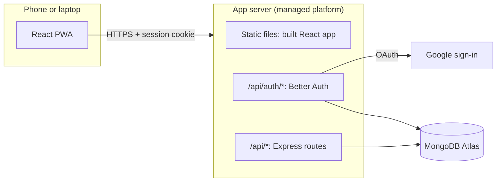
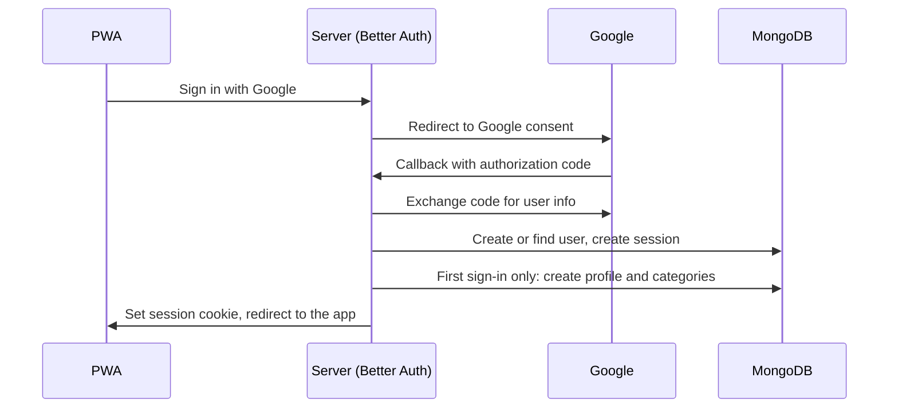
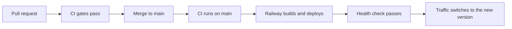

# Money Management App — Technical Design

This document describes **how** the app is built. `SPEC.md` describes **what** it does; when they disagree, the spec wins and this document is updated.

## 1. Key decisions

Each decision records what was chosen, why, and what was rejected. Changing a decision means updating its entry here first.

### 1.1 Hosting: one always-on server on a paid managed platform

- **Chosen:** a single Node.js server on Railway's Hobby plan, within ₹500/month (details in Section 11).
- **Why:**
  - It stays always on, so there are no slow first loads (Spec Rule 4, the 5-second rule).
  - A normal long-running Express server is simpler than serverless: one database connection pool, no cold starts, no function size limits.
  - The platform provides HTTPS, a subdomain and deploys from git, so there is no server administration.
- **Rejected:**
  - *Serverless functions on a free tier:* free, but they need connection reuse tricks and behave differently from a normal server.
  - *A raw VPS:* cheaper, but adds Docker, a reverse proxy, TLS certificates and server maintenance.
  - *Free hosts that sleep when idle:* break the 5-second rule.
- **Region:** the server and the database run in the same region, as close to India as the platform allows.

### 1.2 Frontend served by the same server

- **Chosen:** the Express server serves the built React app as static files, and the API under `/api`.
- **Why:** one deploy, one domain. The session cookie is always first-party (Spec Rule 11), and no CORS setup is needed.
- **Rejected:** *a separate static host proxying `/api`:* two deploys to keep in sync, for no benefit at this size.

### 1.3 Auth: Better Auth with Google sign-in

- **Chosen:** Better Auth, using its MongoDB adapter and Google provider.
- **Why:**
  - TypeScript-first, and it runs inside the Express server.
  - Sessions are stored in the database, which makes "log out of all devices" (Spec Rule 10) a single delete.
  - It handles the OAuth flow, secure cookies and session expiry, which are easy to get wrong by hand.
- **Rejected:** *Passport.js + express-session:* more pieces to wire up manually, older and less type-safe.

### 1.4 Database access: official MongoDB driver + Zod

- **Chosen:** MongoDB Atlas (free tier), accessed with the official `mongodb` driver. Data shapes are defined once as Zod schemas.
- **Why:**
  - One Zod schema gives the TypeScript type, runtime validation of API input, and the same validation in the frontend form.
  - The driver is thin and close to how MongoDB actually works, which suits the learning goal.
  - Multi-document transactions (Spec Rule 11) work directly with the driver's sessions.
- **Rejected:** *Mongoose:* its schemas would duplicate the Zod schemas, and it hides some of what the database is doing.

### 1.5 Repo: pnpm workspaces monorepo

- **Chosen:** one repository, managed with pnpm workspaces.
- **Why:** frontend and backend share types and validation through a shared package. One install, one CI pipeline, and a change across both sides lands in one commit.
- **Rejected:** *npm workspaces:* works, but pnpm is faster and stricter about undeclared dependencies.

## 2. Architecture overview



**Components:**

- **React PWA:** the whole user interface. Installable on phones. It has no offline data (Spec Rule 3); its service worker only caches the app's own files so it loads fast.
- **App server:** one Express process that serves three things:
  - the built React app as static files, for any path not under `/api`
  - Better Auth under `/api/auth/*`, for Google sign-in, sessions and logout
  - the app's REST API under `/api/*`
- **MongoDB Atlas:** stores all app data and the auth sessions.
- **Google:** only involved during sign-in.

**A typical request** (adding an expense):

1. The PWA sends `POST /api/transactions` with the session cookie.
2. The server checks the session and finds the user.
3. The input is validated against the shared Zod schema.
4. The business rules run, and the transaction is written to MongoDB, owned by that user.
5. The server returns the saved transaction; the PWA updates the screen.

**No background jobs.** Everything time-based is either calculated when data is read, or handled by the database:

| Behaviour                                   | How                                                    |
| ------------------------------------------- | ------------------------------------------------------ |
| Upcoming and overdue bills, goals, lending  | Calculated on read, using "today" in the user's timezone |
| Backup reminder                             | Calculated on read from the user's last backup date    |
| Emptying the Trash after 30 days            | A MongoDB TTL index on `deletedAt`                     |

This means there is no scheduler to run, monitor or pay for.

**Time:** the server always calculates "today" from the user's stored timezone (Spec Rule 9), never from the server's clock or the device's clock alone.

## 3. Repo structure

```text
money-mng/
├── apps/
│   ├── api/                      Express server
│   │   └── src/
│   │       ├── main.ts           starts the server
│   │       ├── app.ts            builds the Express app (used by main.ts and API tests)
│   │       ├── container.ts      awilix container: registers everything
│   │       ├── config.ts         reads and validates environment variables
│   │       ├── db/               MongoDB client, indexes, transaction helper
│   │       ├── auth/             Better Auth setup
│   │       ├── middleware/       requireAuth, validate, rate limit, error handler
│   │       └── modules/          one folder per feature (see section 4)
│   │           ├── users/        signup setup, settings, backup, account deletion
│   │           ├── categories/
│   │           ├── transactions/
│   │           ├── reports/
│   │           ├── bills/
│   │           ├── lending/
│   │           └── goals/
│   └── web/                      React + Vite PWA (see section 8)
├── packages/
│   └── shared/                   used by both api and web
│       └── src/
│           ├── schemas/          Zod schemas and their TypeScript types
│           ├── money.ts          paise conversion and ₹ formatting
│           └── dates.ts          calendar dates and timezone helpers
├── SPEC.md
├── DESIGN.md
└── pnpm-workspace.yaml
```

**What goes in `packages/shared`:** only code that both the frontend and backend need: Zod schemas, money and date helpers. Business rules that only the server runs stay in `apps/api`.

## 4. Backend layers and patterns

### 4.1 Feature modules

Each feature in `apps/api/src/modules/` has the same files:

```text
modules/bills/
├── bills.routes.ts        HTTP: paths, validation, status codes
├── bills.service.ts       use cases: "pay a bill", "skip a cycle"
├── bills.repository.ts    MongoDB reads and writes
├── bills.domain.ts        pure business rules
└── bills.domain.test.ts   unit tests for the domain functions
```

A feature with no complex rules (e.g. categories) may have no `domain.ts`.

### 4.2 Layers

| Layer          | Does                                                         | Never                                    |
| -------------- | ------------------------------------------------------------ | ---------------------------------------- |
| **Routes**     | Parse the request, validate input with Zod, call one service function, send the response | Touch the database or contain business rules |
| **Service**    | Run a use case: load data, apply domain rules, save, wrap multi-record writes in a DB transaction | Use `req` / `res`                       |
| **Repository** | Read and write one collection, always filtered by user       | Contain business rules                  |
| **Domain**     | Pure functions: same input, same output, no database, no clock | Import from any other layer            |

Allowed calls go one way: routes → service → repository and domain.

**Domain examples** (Spec Rule 16 tests live here):

- `nextDueDate(dueDate, dueDay, frequency)` — bill date rolling, including the 29th–31st
- `remainingAmount(record, repayments)` and `isSettled(...)` — lending
- `goalStatus(goal, contributions, today)` — savings goals
- `calculateBalance(openingBalance, openingDate, transactions)`
- `comparisonRange(month, today)` — month comparison date ranges

Domain functions receive "today" as a parameter instead of reading the clock, so tests can pass any date.

### 4.3 Code style

- Plain functions and modules; no classes.
- Each service and repository is a factory function that receives its dependencies and returns an object of functions:

```ts
export function createBillsService({ billsRepository, transactionsRepository, db }: Deps) {
  return {
    async payBill(userId: string, billId: string, input: PayBillInput) { /* ... */ },
    async skipCycle(userId: string, billId: string) { /* ... */ },
  };
}
```

### 4.4 Dependency injection: awilix

- `container.ts` registers the database, config, every repository and every service with awilix, as singletons.
- Factory functions receive their dependencies by name from the container (e.g. `{ billsRepository }`).
- Routes resolve the service they need from the container.
- API tests build a container with fake or test-database dependencies.

### 4.5 Ownership rule

Ownership is enforced in the repository layer, so it can't be forgotten (Spec Rule 10):

- Every service function takes the logged-in `userId` as its first argument. It comes from the session, never from the request body.
- Every repository query includes `userId` in its filter, including updates and deletes.
- A record that exists but belongs to someone else is treated exactly like a record that doesn't exist (404), so other users' ids can't be probed.

### 4.6 Cross-feature writes and DB transactions

Some actions write to more than one feature (e.g. paying a bill creates a transaction).

- A service may call **another feature's repository** for this, never another feature's routes.
- Multi-record writes run inside `withTransaction(async (session) => { ... })` from `db/`. Every repository function accepts an optional `session`, so all writes in the block commit or roll back together (Spec Rule 11).

## 5. Database collections and indexes

### 5.1 Conventions

- **Ids:** MongoDB `ObjectId` for every document and every embedded item. Sent to the frontend as strings.
- **Owner:** every app collection has a `userId` field (Section 4.5).
- **Money:** whole numbers of paise, always positive. Whether money comes in or goes out is decided by `type` or `direction`, never by a minus sign. Zod checks every amount is an integer.
- **Calendar dates** (transaction date, due dates, deadlines): `"YYYY-MM-DD"` strings. They never shift with timezones, and they sort and compare correctly as plain strings.
- **Timestamps** (`createdAt`, `updatedAt`, `deletedAt`, `completedAt`, `settledAt`, `lastBackupAt`): MongoDB `Date` values, in UTC.
- **Indexes** are created by `db/indexes.ts` when the server starts.

### 5.2 Auth collections

Better Auth creates and manages its own collections for users, sessions and linked Google accounts. App code never writes to them directly; it only reads the user's id from the session. The Better Auth user id is the `userId` used everywhere else.

### 5.3 App collections

**`profiles`** — app settings for a user, one per user.

| Field                | Type          | Notes                     |
| -------------------- | ------------- | ------------------------- |
| `userId`             | string        | Better Auth user id       |
| `timezone`           | string        | e.g. `"Asia/Kolkata"`     |
| `openingBalance`     | integer paise | may be 0                  |
| `openingBalanceDate` | date string   |                           |
| `currency`           | string        | `"INR"`                   |
| `lastBackupAt`       | Date or null  |                           |
| `onboardedAt`        | Date or null  | null until the signup flow is finished or skipped (Section 7.2) |

**`categories`**

| Field       | Type    | Notes                                   |
| ----------- | ------- | --------------------------------------- |
| `userId`    | string  |                                         |
| `name`      | string  | as typed                                |
| `nameLower` | string  | lowercase copy, for the uniqueness rule |
| `type`      | string  | `"expense"`, `"income"` or `"both"`     |
| `builtIn`   | boolean | true only for Lending                   |

**`transactions`**

| Field        | Type            | Notes                                                  |
| ------------ | --------------- | ------------------------------------------------------ |
| `userId`     | string          |                                                        |
| `type`       | string          | `"expense"` or `"income"`                              |
| `amount`     | integer paise   |                                                        |
| `currency`   | string          | `"INR"`                                                |
| `categoryId` | ObjectId        |                                                        |
| `date`       | date string     |                                                        |
| `payee`      | string or null  |                                                        |
| `note`       | string or null  |                                                        |
| `source`     | object          | `{ kind: "manual" }`, `{ kind: "bill", billCycleId }`, `{ kind: "lending", recordId, repaymentId? }` |
| `deletedAt`  | Date or null    | set when moved to the Trash                            |
| `requestId`  | string or null  | client-generated id, prevents duplicate saves on retry (Section 6.4) |

**`goals`** — contributions are embedded.

| Field           | Type               | Notes                                  |
| --------------- | ------------------ | -------------------------------------- |
| `userId`        | string             |                                        |
| `name`          | string             |                                        |
| `targetAmount`  | integer paise      |                                        |
| `currency`      | string             |                                        |
| `deadline`      | date string or null|                                        |
| `icon`          | string             |                                        |
| `contributions` | array              | `{ _id, amount, date }`                |
| `completedAt`   | Date or null       |                                        |

**`bills`**

| Field         | Type          | Notes                                     |
| ------------- | ------------- | ----------------------------------------- |
| `userId`      | string        |                                           |
| `name`        | string        |                                           |
| `amount`      | integer paise | the usual amount                          |
| `currency`    | string        |                                           |
| `categoryId`  | ObjectId      |                                           |
| `frequency`   | string        | `"monthly"` or `"quarterly"`              |
| `dueDay`      | integer 1–31  | day of month from the first due date      |
| `nextDueDate` | date string   |                                           |
| `paused`      | boolean       |                                           |
| `note`        | string or null|                                           |

**`billCycles`** — a separate collection, because it grows every month for as long as a bill exists.

| Field           | Type             | Notes                    |
| --------------- | ---------------- | ------------------------ |
| `userId`        | string           |                          |
| `billId`        | ObjectId         |                          |
| `dueDate`       | date string      | the cycle this closes    |
| `status`        | string           | `"paid"` or `"skipped"`  |
| `amount`        | integer paise or null | amount paid         |
| `transactionId` | ObjectId or null | set when paid            |

**`lendingRecords`** — repayments are embedded.

| Field           | Type               | Notes                                          |
| --------------- | ------------------ | ---------------------------------------------- |
| `userId`        | string             |                                                |
| `person`        | string             |                                                |
| `direction`     | string             | `"lent"` or `"borrowed"`                       |
| `amount`        | integer paise      | original amount                                |
| `currency`      | string             |                                                |
| `date`          | date string        |                                                |
| `dueDate`       | date string or null|                                                |
| `note`          | string or null     |                                                |
| `transactionId` | ObjectId           | the transaction for the original lend/borrow   |
| `repayments`    | array              | `{ _id, amount, date, transactionId }`         |
| `settledAt`     | Date or null       |                                                |

Every collection also has `_id`, `createdAt` and `updatedAt`.

### 5.4 Indexes

| Collection       | Index                                    | Purpose                                                    |
| ---------------- | ---------------------------------------- | ---------------------------------------------------------- |
| `profiles`       | `{ userId: 1 }` unique                   | one profile per user                                       |
| `categories`     | `{ userId: 1, nameLower: 1 }` unique     | category names unique per user (Spec Rule 5)               |
| `transactions`   | `{ userId: 1, date: -1 }`                | transaction list, monthly totals, balance                  |
| `transactions`   | `{ userId: 1, categoryId: 1, date: -1 }` | category filters and reports                               |
| `transactions`   | `{ userId: 1, payee: 1 }`                | payee autocomplete                                         |
| `transactions`   | `{ deletedAt: 1 }` TTL, 30 days          | empties the Trash automatically (Spec Rule 9)              |
| `transactions`   | `{ userId: 1, requestId: 1 }` unique, only where `requestId` is set | a retried save can't create a duplicate (Section 6.4) |
| `goals`          | `{ userId: 1, completedAt: 1 }`          | active and completed lists                                 |
| `bills`          | `{ userId: 1, nextDueDate: 1 }`          | upcoming and overdue bills                                 |
| `billCycles`     | `{ billId: 1, dueDate: 1 }` unique       | history; **makes paying the same cycle twice impossible**  |
| `lendingRecords` | `{ userId: 1, settledAt: 1 }`            | open and settled lists                                     |
| `lendingRecords` | `{ userId: 1, person: 1 }`               | person autocomplete                                        |

Search by note or payee scans the user's transactions with the `userId` index. At one person's data volume this is fast enough; a text index can be added later if needed.

### 5.5 Deleting an account

Deleting an account (Spec Rule 10) runs in one DB transaction: delete every document with that `userId` from every app collection, then delete the user's Better Auth data.

## 6. API contract

### 6.1 Conventions

- **Base path:** `/api/v1`. Better Auth's own endpoints live at `/api/auth/*` and are not versioned.
- **Format:** JSON in and out. Field names in `camelCase`.
- **Amounts:** integers in paise, in both directions. The frontend converts to and from ₹ for display (`packages/shared/money.ts`).
- **Dates:** calendar dates as `"YYYY-MM-DD"`, months as `"YYYY-MM"`, timestamps as ISO 8601 strings in UTC.
- **Auth:** every `/api/v1` endpoint requires a valid session cookie, or returns `401`.
- **Validation:** every request body and query is validated with the shared Zod schema before reaching the service.

### 6.2 Response envelope

Success:

```json
{ "success": true, "data": { "id": "6730f1...", "amount": 12550, "type": "expense" } }
```

Failure:

```json
{
  "success": false,
  "error": {
    "code": "VALIDATION_ERROR",
    "message": "Amount must be greater than 0",
    "details": [{ "field": "amount", "message": "Must be greater than 0" }]
  }
}
```

| HTTP status | `error.code`        | When                                                             |
| ----------- | ------------------- | ---------------------------------------------------------------- |
| 400         | `VALIDATION_ERROR`  | input fails the Zod schema                                       |
| 401         | `UNAUTHENTICATED`   | no valid session                                                 |
| 404         | `NOT_FOUND`         | record doesn't exist **or belongs to another user** (Section 4.5) |
| 409         | `CONFLICT`          | duplicate category name, bill cycle already paid                 |
| 422         | `RULE_VIOLATION`    | valid input that breaks a spec rule, e.g. repayment larger than the remaining amount |
| 429         | `RATE_LIMITED`      | too many requests                                                |
| 500         | `INTERNAL_ERROR`    | anything unexpected; details are logged, never sent to the client |

Section 9 covers how errors are raised and handled in code.

### 6.3 Pagination

Lists that can grow large (transactions, Trash) use cursor pagination:

- Request: `?limit=50&cursor=<opaque string>`. Default limit 50, maximum 100.
- Response: `{ "items": [...], "nextCursor": "..." }`. `nextCursor` is `null` on the last page.
- Sorted by `date` descending, then `_id` descending. The cursor encodes both, so adding new transactions never shifts or repeats items.

Small lists (categories, bills, goals, lending records) are returned whole, without pagination.

### 6.4 Duplicate protection

`POST /transactions` accepts an optional `requestId`, a UUID the form generates once when it opens. If a request with the same `requestId` was already saved, the server returns the existing transaction instead of creating another. This makes **Retry** after a failed save safe (Spec Rule 4).

The same protection exists for bill payments through the unique `billCycles` index (Section 5.4).

### 6.5 Endpoints

All paths below are under `/api/v1`.

**Profile and account**

| Method | Path                | Does                                                         |
| ------ | ------------------- | ------------------------------------------------------------ |
| GET    | `/me`               | name, email and profile settings                             |
| PATCH  | `/me`               | update timezone, opening balance, opening balance date       |
| GET    | `/me/backup`        | download all data as a JSON file; updates `lastBackupAt`     |
| DELETE | `/me`               | delete account; body `{ confirmation }` must match the phrase |

Log out and log out of all devices use Better Auth's endpoints under `/api/auth/*`.

**Health** (no auth, outside `/api/v1`)

| Method | Path          | Does                                                    |
| ------ | ------------- | ------------------------------------------------------- |
| GET    | `/api/health` | `200` if the server can reach the database (Section 11.2) |

**Home**

| Method | Path    | Does                                                                                   |
| ------ | ------- | -------------------------------------------------------------------------------------- |
| GET    | `/home` | balance, this month's totals, top 3 categories, upcoming and overdue bills, overdue lending, backup reminder flag |

**Categories**

| Method | Path              | Does                                                                  |
| ------ | ----------------- | --------------------------------------------------------------------- |
| GET    | `/categories`     | all categories                                                        |
| POST   | `/categories`     | create                                                                |
| PATCH  | `/categories/:id` | rename                                                                |
| DELETE | `/categories/:id` | delete; body `{ moveToCategoryId }` required if it has transactions or bills |

**Transactions**

| Method | Path                              | Does                                                     |
| ------ | --------------------------------- | -------------------------------------------------------- |
| GET    | `/transactions`                   | list; filters `from`, `to`, `categoryId`, `q`; paginated |
| POST   | `/transactions`                   | create a manual transaction                              |
| GET    | `/transactions/:id`               | one transaction                                          |
| PATCH  | `/transactions/:id`               | edit (manual transactions only)                          |
| DELETE | `/transactions/:id`               | move to Trash (manual transactions only)                 |
| GET    | `/transactions/trash`             | Trash list; paginated                                    |
| POST   | `/transactions/:id/restore`       | restore from Trash                                       |
| DELETE | `/transactions/:id/permanent`     | delete permanently from Trash                            |
| GET    | `/transactions/payees?q=`         | payee autocomplete                                       |

Editing or deleting a bill or lending transaction directly returns `422 RULE_VIOLATION` (Spec Rule 9).

**Reports** — all accept `includeLending=true|false` (default `true`, Spec Rule 8).

| Method | Path                               | Does                                                     |
| ------ | ---------------------------------- | -------------------------------------------------------- |
| GET    | `/reports/summary?month=`          | spending per category, income vs expense, for the month  |
| GET    | `/reports/trend?months=6`          | total spending per month, for the bar chart              |
| GET    | `/reports/comparison?month=`       | per-category comparison with the previous month, same date range |

**Bills**

| Method | Path                  | Does                                               |
| ------ | --------------------- | -------------------------------------------------- |
| GET    | `/bills`              | all bills, with upcoming/overdue status            |
| POST   | `/bills`              | create                                             |
| GET    | `/bills/:id`          | one bill with its cycle history                    |
| PATCH  | `/bills/:id`          | edit                                               |
| DELETE | `/bills/:id`          | delete; past transactions become manual            |
| POST   | `/bills/:id/pay`      | pay the current cycle; body `{ amount }`           |
| POST   | `/bills/:id/skip`     | skip the current cycle                             |
| POST   | `/bills/:id/undo`     | undo the most recent cycle                         |
| POST   | `/bills/:id/pause`    | pause                                              |
| POST   | `/bills/:id/resume`   | resume; body `{ nextDueDate }`                     |

**Lending**

| Method | Path                                   | Does                                         |
| ------ | -------------------------------------- | -------------------------------------------- |
| GET    | `/lending`                             | records; filters `direction`, `status`       |
| POST   | `/lending`                             | create a record and its transaction          |
| GET    | `/lending/:id`                         | one record with repayments                   |
| PATCH  | `/lending/:id`                         | edit; updates its transaction                |
| DELETE | `/lending/:id`                         | delete record, repayments and transactions   |
| POST   | `/lending/:id/repayments`              | add a repayment and its transaction          |
| PATCH  | `/lending/:id/repayments/:repaymentId` | edit a repayment                             |
| DELETE | `/lending/:id/repayments/:repaymentId` | delete a repayment and its transaction       |
| GET    | `/lending/people?q=`                   | person autocomplete                          |

**Goals**

| Method | Path                                        | Does                          |
| ------ | ------------------------------------------- | ----------------------------- |
| GET    | `/goals`                                    | goals; filter `status`        |
| POST   | `/goals`                                    | create                        |
| GET    | `/goals/:id`                                | one goal with contributions   |
| PATCH  | `/goals/:id`                                | edit                          |
| DELETE | `/goals/:id`                                | delete                        |
| POST   | `/goals/:id/contributions`                  | add a contribution            |
| PATCH  | `/goals/:id/contributions/:contributionId`  | edit a contribution           |
| DELETE | `/goals/:id/contributions/:contributionId`  | delete a contribution         |

## 7. Auth and sessions

### 7.1 Sign-in flow



Better Auth handles every step of the OAuth exchange. The app only adds the first-sign-in setup.

### 7.2 First sign-in setup (Spec Rule 13)

- A Better Auth hook runs after a user is created and calls `ensureProfile(userId)`, which creates:
  - the profile, with timezone `Asia/Kolkata`, opening balance 0 and `onboardedAt` null
  - the default categories and the built-in Lending category
- `ensureProfile` does nothing if the profile already exists. The auth middleware also calls it when a signed-in user has no profile, so a failed hook can never leave a user without one.
- While `onboardedAt` is null, the PWA shows the signup screen. It sends the device's detected timezone and the opening balance with `PATCH /me`, which sets `onboardedAt`. Skipping sends only the timezone.

### 7.3 Sessions

- Stored in MongoDB by Better Auth; the cookie holds only the session token.
- Cookie: `httpOnly`, `Secure` in production, `SameSite=Lax`.
- **Sliding expiry:** a session expires after 30 days without use. Better Auth extends it at most once a day when it's used, so it isn't rewritten on every request.
- Every request checks the session against the database (no cookie caching), so logging out of all devices takes effect immediately.
- **Log out:** deletes the current session. **Log out of all devices:** deletes every session of the user. Both use Better Auth's built-in endpoints.

### 7.4 Protecting the API

- **`requireAuth` middleware** on every `/api/v1` route: reads the session through Better Auth, puts the user id on the request, and returns `401 UNAUTHENTICATED` if there is none. Services receive this id as `userId` (Section 4.5).
- **Cross-site request protection:** `SameSite=Lax` stops the browser sending the cookie with requests from other sites. In addition, every `POST`, `PATCH` and `DELETE` must have an `Origin` header matching the app's own origin, or it is rejected.
- **Rate limits:** Better Auth's built-in limiter on `/api/auth/*`; `express-rate-limit` on `/api/v1`, keyed by user id when signed in and by IP address otherwise. Limits are set in config.

### 7.5 Google setup

- One Google Cloud OAuth client, with the production and local callback URLs registered.
- Only the basic `email` and `profile` scopes are requested.
- The client id, client secret and Better Auth's signing secret are environment variables (Section 11), never committed.

## 8. Frontend structure

### 8.1 Libraries

| Concern          | Choice                                         |
| ---------------- | ---------------------------------------------- |
| Styling          | Tailwind CSS                                   |
| UI components    | shadcn/ui (copied into the repo, editable)     |
| Server data      | TanStack Query                                 |
| Routing          | React Router                                   |
| Forms            | React Hook Form + the shared Zod schemas       |
| Charts           | Recharts                                       |
| PWA              | `vite-plugin-pwa`                              |

### 8.2 Folder structure

```text
apps/web/src/
├── main.tsx
├── app/
│   ├── router.tsx            all routes and route guards
│   ├── providers.tsx         QueryClient, theme
│   └── layout/               app shell: bottom tabs / sidebar, Add button, offline banner
├── features/                 one folder per feature, mirroring the API modules
│   └── transactions/
│       ├── api.ts            TanStack Query hooks: useTransactions, useCreateTransaction...
│       ├── components/       feature-specific components (AddTransactionSheet...)
│       └── pages/            route screens (TransactionsPage, TrashPage)
├── components/
│   ├── ui/                   shadcn/ui components
│   └── ...                   shared app components: MoneyInput, DateInput, CategoryPicker, EmptyState
└── lib/
    ├── api-client.ts         fetch wrapper (Section 8.4)
    └── query-keys.ts         all TanStack Query keys in one place
```

### 8.3 Routes

| Path                    | Screen                                |
| ----------------------- | ------------------------------------- |
| `/sign-in`              | Google sign-in                        |
| `/welcome`              | first sign-in setup (Spec Rule 13)    |
| `/`                     | Home                                  |
| `/transactions`         | transaction list                      |
| `/transactions/trash`   | Trash                                 |
| `/reports`              | Reports                               |
| `/plan/bills`, `/plan/bills/:id`     | bills list and detail    |
| `/plan/goals`, `/plan/goals/:id`     | goals list and detail    |
| `/plan/lending`, `/plan/lending/:id` | lending list and detail  |
| `/settings`, `/settings/categories`  | Settings                 |

**Route guards:** not signed in → `/sign-in`. Signed in but `onboardedAt` is null → `/welcome`. Everyone else reaches the app.

**URL state:** filters, search and the selected month live in the URL's search params (e.g. `/reports?month=2026-11`), so they survive a refresh and the back button works.

### 8.4 Talking to the API

- `api-client.ts` is the only place that calls `fetch`. It:
  - sends requests to `/api/v1` on the same origin, with cookies
  - unwraps `{ success, data }` and returns `data`
  - turns `{ success: false, error }` into a thrown `ApiError` with the code, message and field details
  - on `401`, sends the user to `/sign-in`
- Every feature's `api.ts` wraps the client in TanStack Query hooks. Components never call the client directly.
- **Caching:** after a change succeeds, the related queries are invalidated and refetched. For example, creating a transaction refreshes transactions, reports and Home.
- **Retries:** reads retry automatically up to 2 times. Writes never retry automatically; the form shows **Retry** and reuses its `requestId` (Section 6.4).
- **No optimistic updates** in the first version: the screen shows what the server saved, never a guess.

### 8.5 Forms and money input

- Forms use React Hook Form with the **same Zod schema** the server uses, so validation messages match on both sides.
- `MoneyInput` lets me type rupees (`125.50`) and gives the form paise (`12550`), using `packages/shared/money.ts`. It opens the number keypad on phones.
- `CategoryPicker` filters by transaction type and shows recently used categories first (Spec Rule 4).

### 8.6 Layout and theme

- **Responsive:** below Tailwind's `md` breakpoint, a bottom tab bar and a floating Add button; from `md` up, a sidebar and an Add button in the top bar (Spec Rule 12).
- **Add transaction** opens as a bottom sheet on phones and a dialog on laptops, from any screen.
- **Theme:** follow device, light or dark, chosen in Settings and stored in the device's `localStorage` (it isn't sensitive). Implemented with shadcn/ui's CSS variables and a `dark` class on `<html>`.
- **Accessibility:** shadcn/ui components are built on accessible primitives; every input has a label.

### 8.7 PWA

- `vite-plugin-pwa` generates the manifest, icons and service worker.
- The service worker caches only the app's own files (HTML, JS, CSS, icons). It **never caches `/api` responses**, so the app never shows stale money data (Spec Rule 3).
- When a new version is deployed, the app shows "Update available, reload".

### 8.8 Local development

The Vite dev server proxies `/api` to the local Express server, so development also runs on one origin, exactly like production.

## 9. Validation and error handling

### 9.1 Where validation happens

| Layer                 | Checks                                                     | On failure                    |
| --------------------- | ---------------------------------------------------------- | ----------------------------- |
| Frontend form         | shared Zod schema, for instant feedback                    | inline field errors           |
| API `validate` middleware | the same Zod schema, on body, query and params; **this is the authority** | `400 VALIDATION_ERROR` |
| Service and domain    | spec rules that need data: repayment ≤ remaining, category type matches, linked transactions can't be edited directly | `422 RULE_VIOLATION` |
| Database              | unique indexes: category names, bill cycles, request ids   | `409 CONFLICT`                |

The frontend check is only for convenience. The server never trusts the client.

### 9.2 Error types

Errors are the one place classes are used, because JavaScript errors must extend `Error`. They live in `apps/api/src/errors.ts`:

| Error                  | Status | Code                |
| ---------------------- | ------ | ------------------- |
| `ValidationError`      | 400    | `VALIDATION_ERROR`  |
| `UnauthenticatedError` | 401    | `UNAUTHENTICATED`   |
| `NotFoundError`        | 404    | `NOT_FOUND`         |
| `ConflictError`        | 409    | `CONFLICT`          |
| `RuleViolationError`   | 422    | `RULE_VIOLATION`    |

All extend `AppError`, which carries the status, code, message and optional field details. Services and domain functions throw these; they never build HTTP responses.

### 9.3 Error middleware

The server uses **Express 5**, which passes errors from async route handlers to the error middleware automatically. One error middleware, registered last, turns every error into the envelope from Section 6.2:

| Error caught                         | Response                                  |
| ------------------------------------ | ----------------------------------------- |
| `AppError`                           | its own status, code and message          |
| `ZodError`                           | `400 VALIDATION_ERROR` with field details |
| MongoDB duplicate key (code `11000`) | `409 CONFLICT`                            |
| Anything else                        | `500 INTERNAL_ERROR`, message "Something went wrong" |

For a `500`, the full error and stack trace are logged, but the client only sees the generic message and the request id.

If the process hits an unhandled promise rejection or exception, it logs the error and exits; the hosting platform restarts it.

### 9.4 Logging

- **pino** with `pino-http`, writing JSON lines to standard output, where the hosting platform collects them.
- Every request gets a **request id**, included in every log line for that request and returned in an `X-Request-Id` response header.
- Each request logs: method, path, status, duration and user id.
- **Never logged:** cookies, auth headers, request and response bodies. Bodies contain financial data, and logs are less protected than the database.
- No error tracking service: logs only, keeping Spec Rule 10's no-third-party rule.

### 9.5 Showing errors in the app

| Situation                              | Shown as                                                     |
| -------------------------------------- | ------------------------------------------------------------ |
| Field validation error                 | message under the input (server `details` are mapped onto the form fields) |
| Failed action (save, delete, pay)      | a toast with the server's message; forms keep their data and offer **Retry** |
| A page's data can't load               | a full error screen with **Retry**, using React Router's error boundary |
| Device offline                         | the offline banner (Spec Rule 3)                             |
| Unexpected error (`500`)               | "Something went wrong", with the request id in small text for debugging |

## 10. Quality gates

A change reaches production only after passing every gate below, in order.

### 10.1 Gate 1: before each commit (my machine)

- **husky** runs a pre-commit hook, which uses **lint-staged** to run `biome check --write` on the staged files only.
- Formatting is fixed automatically; lint errors block the commit.

### 10.2 Gate 2: pull request CI (GitHub Actions)

**Workflow:** every task gets a short-lived branch, then a pull request to `main`. CI runs on every pull request and every push to `main`:

| Step          | Command (via pnpm, across all workspaces)    | Fails when                                   |
| ------------- | -------------------------------------------- | -------------------------------------------- |
| Install       | `pnpm install --frozen-lockfile`             | the lockfile doesn't match `package.json`    |
| Lint + format | `biome ci`                                   | any lint error or unformatted file           |
| Type check    | `tsc --noEmit`                               | any type error                               |
| Unit tests    | Vitest                                       | any failing test                             |
| Coverage      | Vitest coverage on `*.domain.ts` files       | domain line or branch coverage below **90%** |
| API tests     | Vitest + Supertest against an in-memory MongoDB replica set | any failing test          |
| Build         | build `web` and `api`                        | the build fails                              |

API tests use `mongodb-memory-server`'s replica set mode, because MongoDB transactions (Section 4.6) only work on a replica set. No Docker needed.

### 10.3 Gate 3: branch protection on `main`

- Direct pushes to `main` are blocked; changes arrive only through pull requests.
- Every CI step above must pass before merging.
- No required reviewer, since I'm the only developer. Instead, a pull request template has a self-review checklist (the definition of done below).
- Force pushes to `main` are blocked.

### 10.4 Code rules enforced by tooling

- TypeScript `strict` mode in every workspace.
- Biome's `noExplicitAny` rule is an error.
- **Dependabot** opens weekly pull requests for dependency updates, which go through the same CI.

### 10.5 Definition of done

A task is done when:

- [ ] It does what the spec says, and `SPEC.md` / `DESIGN.md` are updated if behaviour or design changed.
- [ ] Tests required by Spec Rule 16 for this area are written and pass.
- [ ] Every CI gate passes.
- [ ] It works on a phone-sized screen and a laptop-sized screen.
- [ ] Errors are handled as in Section 9; no unhandled loading or empty states.

## 11. Deployment and environments

### 11.1 Environments

| Environment | App runs on                     | Database                                  |
| ----------- | ------------------------------- | ----------------------------------------- |
| Local       | my machine (Vite + Express)     | a separate free Atlas cluster for development |
| Production  | Railway, Hobby plan             | the production free Atlas cluster         |
| Tests       | my machine and CI               | in-memory MongoDB (Section 10.2)          |

There is no staging environment. Pull request CI and local testing cover that role.

Atlas allows one free cluster per project, so development and production use **two Atlas projects**. Development data never touches production.

### 11.2 Production setup

- **Railway**, one service in the **Singapore** region, on the platform's free subdomain (e.g. `money-mng.up.railway.app`).
- **Atlas** production cluster in the same or the nearest region, to keep database round trips short.
- **Build:** `pnpm build` builds `web` and `api`. **Start:** one Node process runs the API, which also serves `web`'s built files (Section 1.2).
- **Health check:** `GET /api/health` (no auth) returns `200` when the server can reach the database. Railway uses it to decide whether a new deployment is healthy before switching traffic to it.

**Atlas network access:** Railway's outgoing IP addresses are not fixed on the Hobby plan, so Atlas has to allow connections from any IP. The database is then protected by its username and a long random password only. If the setup changes later, revisit this first.

### 11.3 Deploy flow



- Railway deploys automatically from `main`, with its "wait for CI" option enabled, so a commit that fails CI is never deployed.
- If the health check fails, Railway keeps the previous version running.
- **Rollback:** redeploy the previous deployment from Railway's dashboard.

### 11.4 Configuration and secrets

`apps/api/src/config.ts` reads these environment variables and validates them with Zod at startup. If any is missing or invalid, the server refuses to start.

| Variable               | Example / notes                                   |
| ---------------------- | ------------------------------------------------- |
| `NODE_ENV`             | `development` or `production`                     |
| `PORT`                 | set by Railway in production                      |
| `APP_URL`              | the app's origin, used by Better Auth and the Origin check (Section 7.4) |
| `MONGODB_URI`          | Atlas connection string                           |
| `BETTER_AUTH_SECRET`   | long random string                                |
| `GOOGLE_CLIENT_ID`     | from Google Cloud                                 |
| `GOOGLE_CLIENT_SECRET` | from Google Cloud                                 |
| `LOG_LEVEL`            | `info` in production, `debug` locally             |

- Production values are stored in Railway's variables. Local values live in `apps/api/.env`, which is git-ignored.
- `apps/api/.env.example` lists every variable with no real values and is committed.
- Google's OAuth client has two callback URLs registered: the local one and the production one (Section 7.5).

### 11.5 Database changes

- Indexes are created on startup (Section 5.1). Creating an index that already exists does nothing, so this is safe on every deploy.
- If a change needs existing documents rewritten, it gets a one-off script in `apps/api/scripts/migrations/`, run manually against production after downloading a backup.

### 11.6 Cost

| Item                     | Cost                                          |
| ------------------------ | --------------------------------------------- |
| Railway Hobby            | around $5/month; check current pricing        |
| MongoDB Atlas (2 clusters) | free                                        |
| Google sign-in           | free                                          |
| Domain                   | none; using Railway's subdomain               |

Total: within the ₹500/month budget (Spec Rule 10), as long as Railway's pricing hasn't changed.
